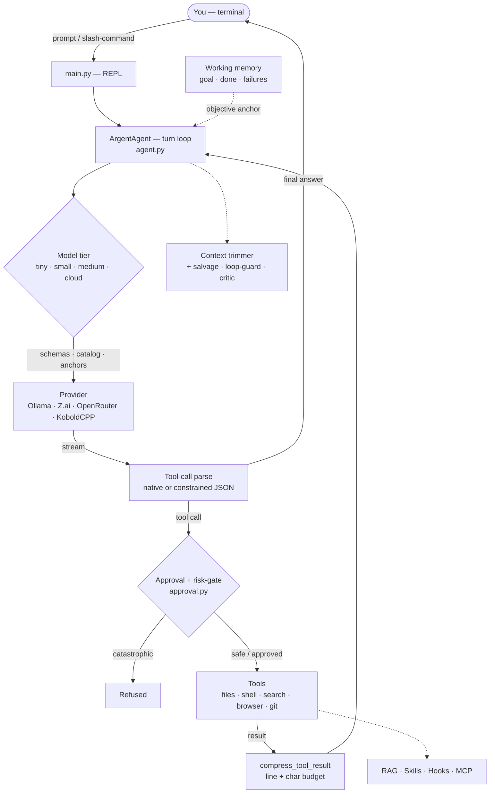

# Argent: The Elite AI Coding Assistant

[](https://github.com/Aslan008/Argent/actions/workflows/ci.yml) [](pyproject.toml) [](pyproject.toml)

Argent is a high-performance, professional AI pair programmer designed to live in your terminal. It supports local **Ollama** models, **Z.ai**, **OpenRouter**, and **KoboldCPP** API providers, leveraging advanced architectural patterns to provide an autonomous, efficient, and secure development environment.

> [!NOTE]
> Argent is a **personal experiment** in building high-autonomy AI agents for terminal-based development.
> [!CAUTION]
> **Warning**: This project is in active development and is considered experimental. Things may not work as expected, logic might fail, or code could potentially break. Use with caution.

---

## 🏗 Architecture

A single turn flows from your prompt through a tier-adaptive strategy, a provider,
and a safety gate before any tool touches your machine — while working memory,
context management and resilience wrap the whole loop.



---

## 🎚 Which autonomy do you want?

"Autonomous" means two different things in Argent. Pick by how much you intend to watch:

| Command | What it does | You are… |
| --- | --- | --- |
| `/vibe [task]` | Safe actions auto-approved, destructive ones still ask, checkpoint every turn | at the keyboard, running tasks quickly |
| `/tasks add …` | Scheduled work with **nobody watching** — gated actions are refused, not approved | asleep |

`/vibe` lets you run tasks fast without hitting 'y' on every safe tool call, while `/tasks` handles scheduled background work. Both are bounded: `/vibe` by per-turn checkpoints and refusal of dangerous actions, `/tasks` by a per-task toolset and turn budget.

---

## 🚀 Key Features

### 🧠 Project Brain (Autonomous Mode)
Argent doesn't just answer questions; it builds entire projects. Utilizing a multi-state machine, Argent can:
- **Research**: Scour the web for the latest documentation.
- **Architect**: Design high-level system structures.
- **Spec**: Generate detailed per-file specifications.
- **Execute**: Implement code autonomously while managing its own context limits.

### 🧪 TDD Mode (Test-Driven Development)
Enable strict TDD to force the AI into a professional **Red-Green-Refactor** cycle. Argent will write failing tests, implement the code, and verify results before moving forward.

### 🪝 Global Plugins & Hooks
Extend Argent's core logic with Python plugins stored in `~/.argent/hooks/` (configurable via `/hooks`).
- **Autonomous Extension**: Argent can autonomously create new specialized tools when needed (toggle via `/hooks auto on`).
- **Lifecycle Hooks**: `on_startup`, `pre_prompt`, `post_response`, `on_tool_call`.
- **Custom Commands**: Define functions starting with `command_` to create your own slash commands.

### 🔍 Synchronous RAG (Semantic Search)
Never worry about outdated knowledge. Argent automatically indexes your codebase using **ChromaDB**. When files are modified, the RAG index is updated incrementally in real-time.

### 🌐 Intelligent Browser Control (CDP & Playwright)
Argent includes a powerful browser automation engine based on Playwright:
- **CDP Mode (User's Browser)**: Connects directly to your real browser (Chrome, Yandex Browser, Edge, Brave) to leverage your active sessions, cookies, and login states.
- **Auto-Attach**: Automatically attaches to your already open tabs without interrupting your workflow.
- **Visual & Structural Analysis**: Recursively crawls DOM trees across nested `iframe` and Shadow DOM boundaries.
- **Smart Filtering**: Supports multi-keyword search queries (logical OR) to filter complex web pages and reduce prompt size, with automatic feedback warnings for over-filtering.
- **Robust Actions**: Interact with elements using dynamic ID indexing, precise CSS selectors, or visible text, with automatic scrolling into view.

### 🚦 Automatic Model-Tier Adaptation (Zero Configuration)
Argent detects the model size from its name and silently adapts the whole pipeline — switch between a 1B local model and a cloud giant without touching a single setting:
- **Tiny models (Ollama)**: every agent step is **grammar-constrained at the decoder level** to a strict JSON schema — malformed tool calls become physically impossible to generate, not merely repaired afterwards. A compact tool catalog and an objective reminder are pinned near the end of the prompt, where small models actually attend.
- **Standard local models**: native tool calling plus the objective anchor for long histories.
- **Cloud models**: completely unburdened — no schemas, no catalogs, no reminders.
- **All tiers**: a deterministic **loop guard** catches verbatim-repeated tool calls (the classic small-model failure mode) and force-ends runaway turns; `replace_in_file` auto-corrects whitespace-broken edit targets with re-indentation instead of bouncing errors back.

### 🛡 Centralized Approval & Safe Autonomy
Every dangerous action (shell commands, file deletion, git rollback) passes through a single approval gate:
- **Destructive-command detection**: `rm` / `Remove-Item` / `format` / `git reset --hard` / `taskkill` and friends always require explicit confirmation — even in autonomous mode.
- **Session grants**: approve once with *"always allow `git` this session"* and stop clicking through repeated prompts.
- **Working autonomy**: in `/vibe` mode safe actions are auto-approved so the agent can actually run quickly, while destructive ones still pause for you.

### 📉 Context-Aware Prompting
Every token in the system prompt costs a local model speed and focus, so Argent keeps it lean and tier-adaptive: weak models (tiny/small) get a slimmed core toolset instead of all ~52 schemas (a ~58% cut to the largest part of the prompt), the AGENTS.md memory is capped per tier, and `/stats` shows exactly where the budget goes (system prompt / tool schemas / history).

### 🆓 OpenRouter: free and paid models, one key
OpenRouter requires a single API key (a **free** one from [openrouter.ai/keys](https://openrouter.ai/keys) is enough). With it you can run the zero-cost `:free` models, and the moment you want a frontier model you just pick a paid one — same key, no reconfiguration. `/provider → openrouter` lets you list **free models only** or the full catalog, with free models surfaced first. For fully offline, no-key-at-all usage, Ollama remains the local option.

### 🧮 Exact Mathematics — Arithmetic and Symbolic
The `calculate` tool is two engines behind one entry point. Plain arithmetic runs on a whitelisted AST interpreter; anything symbolic falls through to SymPy: integrals (including improper ones), derivatives, one- and two-sided limits, equations and inequalities, ODEs, matrices, sums and series, statistics, integral transforms, geometry and unit conversion.

```text
integrate(exp(-x**2), (x, -oo, oo))  →  sqrt(pi)  ≈ 1.772453851
summation(1/k**2, (k, 1, oo))        →  pi**2/6   ≈ 1.644934067
dsolve(Derivative(y(x), x, 2) + y(x), y(x))  →  C1*sin(x) + C2*cos(x)
```

Neither path ever executes code. SymPy's own `sympify`/`parse_expr` call `eval` internally, so they are never handed raw model output — the expression is walked as an AST against an explicit whitelist and rebuilt node by node, which leaves no room for attribute access, imports or smuggled strings.

### 🕰 Time Machine — Fearless Editing
Before the **first file edit of every turn**, Argent commits a checkpoint of the pre-turn tree. Read-only turns stay commit-free, and a hand-crafted git index is never overwritten (you are told when a checkpoint is skipped, so you never believe you are covered when you are not).

- `/rewind` — pick any turn checkpoint and roll the whole tree back to it. Real user commits in between abort the rewind; uncommitted work is stashed first.
- `/back` — return to just before your last message: the conversation **and** the files (the button *↩ Вернуться сюда* under it in the TUI). The turn's edits are stashed, one more `/back` goes one message further back; if you committed in between, nothing is touched.
- `/undo <file>` — per-file rollback when only one edit went wrong.
- In natural language: *"вернись до того, как ты сломал меню"* — the agent matches the checkpoint by its message.

### 🌴 Vibe Mode
`/vibe` is one switch over existing knobs: safe actions are auto-approved, destructive ones still prompt, and per-turn checkpoints are guaranteed. The cost of a bad experiment drops to one `/rewind`.

### 🧭 Working in Steps: Plan Mode, Checklist, Sub-agents
- **`/plan [task]`** — plan mode. The agent may only *look* (read, search, the web, read-only shell like `git status` or `grep`); every tool that changes anything is withdrawn and a call to one is refused before it runs. It ends by handing you the full plan (`exit_plan_mode`); your yes turns editing back on, your no sends it back to revise. `/plan off` leaves by hand. The toolbar shows `PLAN`.
- **Checklist** — for any job of three or more steps the agent writes its steps with `todo_write`, and the Rust TUI shows them above the prompt (`✓ done`, `▶ now`, `○ next`). `/todo` prints the list, `/todo clear` drops it.
- **Sub-agents** — `run_subagent(..., background=true)` returns at once and the sub-agent works in its own process, so several can run in parallel (up to 4). `isolation="worktree"` gives one a private git worktree that starts from your tree *as it is now*; its edits come back as a patch you read and apply or drop. In the TUI the agent is woken when a background sub-agent finishes (`wait_heartbeat(until='subagent_finished("1")')` does the same in the REPL). A sub-agent cannot ask you anything: it can run only shell commands you had already allowed, and its refused requests are listed in its report. `/agents` lists them, `/agents diff N` shows a patch, `/agents apply N` / `discard N` / `stop N` act on it.

### 🪝 Hooks, Rules and Review
- **Hooks in JSON** — `.argent/hooks.json` (project) and `~/.argent/hooks.json` (everywhere) bind a shell command to `SessionStart`, `UserPromptSubmit`, `PreToolUse`, `PostToolUse` or `Stop`. Exit code 2 from a `PreToolUse` hook stops the call and tells the model why; `PostToolUse` output (a linter's complaints) is appended to the tool result so the model sees what it just broke. Values reach the hook through `ARGENT_*` environment variables and JSON on stdin, never spliced into the command line. A project's file is code from a repository: it does not run until you have read it and typed `/hooks trust` (an edited file needs trust again). `/hooks list` shows what is configured. Python plugins (`/hooks`) keep working.
  ```json
  {"hooks": {"PostToolUse": [{"matcher": "write_file|replace_in_file", "if": "*.py", "command": "ruff check \"$ARGENT_FILE\""}]}}
  ```
- **Permission rules** — `.argent/permissions.json` / `~/.argent/permissions.json` hold standing `allow`, `ask` and `deny` rules such as `run_command(git status*)` or `write_file(.env*)`. `deny` beats everything (in every mode) and the model is told it is your rule; `ask` asks even in `/vibe`; `allow` approves a non-destructive shell command without a prompt (`*` never crosses `; & |`, so `git status*` cannot be stretched into `git status; rm -rf x`). Edit with `/permissions allow|ask|deny <rule>`; a rules file that came with a repository counts for `deny` and `ask` at once and for `allow` only after `/permissions trust`.
- **`/review [staged|commit|A..B|path] [focus] [--fix]`** — an independent reviewer in a clean context with read-only tools reads your uncommitted changes (or a commit or range) and returns findings with file, line, severity and the concrete input that breaks. It must check each finding against the code first; findings about files that do not exist are dropped. `--fix` hands the findings to the working agent. The critic's model (`/critic model`) is used when set.

### 🚪 Rooms — repeatable recipes with rails
A room is a small JSON graph of steps for a job you do again and again — fix a bug, review a diff, add a feature, check a release, research a question. The engine, not the model, decides which step runs next; each step has hard limits (iterations, tokens, seconds); a verdict such as "the tests are green" comes from a process's exit code (`sets`), never from an agent's say-so; risky steps (a commit) ask you first (`confirm`); and the run ends with a report and a record in `.argent/rooms_runs/`.
- **Nine starter rooms** — `fix_bug`, `debug_loop`, `implement_feature` (plan → you approve it → code → tests → review), `code_review`, `release_check`, `research`, `explain_repo`, `analyze`, `triage`. `/rooms list` shows them with their parameters, `/rooms show <name>` draws one.
- **`/rooms <task>`** picks the room from your words (no model call; asks you when it is not sure), **`/rooms run <room> [key=value] [task]`** runs a named one: `/rooms run debug_loop test_command="python -m pytest tests/unit -q"`. `/rooms resume` continues an interrupted run, `/rooms last` / `history` show what happened.
- **The model can use them too** — the `rooms` tool (`list`, `show`, `run`, `resume`); when your message clearly fits a room the model gets a one-line nudge. Every `run` is put to you first; a room's workers can never start another room.
- **Build rooms like blocks** — `/rooms build <what it should do, in words>` has the model draft a room, shows the diagram and saves only after you say yes; `/rooms edit <room> <change>` changes one the same way (a packaged room is saved as `<name>_custom`). `/rooms editor` opens a visual editor in your browser (drag steps, connect them, set conditions, retries and on-error paths; the same validator checks every save; only your own rooms are written). Blocks: `tool`, `agent`, `condition`, `human_pause`, `set`, `notify`, and `room` — a room can call another room as a sub-routine.
- **Your own rooms** — `/rooms new <name>` writes a template into `.argent/rooms/`, `/rooms validate <file>` checks one, `{{task}}` and `{{param}}` placeholders carry your words into the steps. A room is data, never code: conditions use a closed grammar, agent steps may write only the state fields they declare, and a room that keeps failing is quarantined (`/rooms unquarantine`).

### ⏰ Ambient Automation
Work that happens by itself, on a schedule, while you are away — monitoring, digests, checks, reminders. Three kinds of run, so nothing costs more than it has to:

| Mode | A run is… | Costs |
| --- | --- | --- |
| `agent` (default) | a model working on your task with a narrow toolset | tokens |
| `command` (`/tasks cmd`) | your shell command, exactly as written — tests, backups, health checks | nothing |
| `remind` (`/remind`) | a message delivered at the time you chose | nothing |

```text
/remind in 2 hours | call Anna
/tasks new tests pytest -q                  # hourly on weekdays; speaks only when the tests fail
/tasks new releases astral-sh/uv            # new GitHub releases, only the new ones
/tasks add digest | weekdays at 09:00 | Summarise yesterday's git history | tools: run_command | commands: git log* | notify: always
/tasks cmd backup | daily at 03:00 | python scripts/backup.py | notify: failures
/tasks                                      # what is running, what is next, what needs you
/tasks inbox                                # what happened while you were away
```

You can also just say it: *"every morning check the uv releases"* — the agent uses its `manage_automations` tool and **asks you before anything is saved**. `/tasks templates` lists the ready-made ones (morning digest, tests, a daily command, page watcher, GitHub releases, news by topic, TODO review, outdated dependencies).

**Schedules read like English or Russian, not cron:** `every 30m` · `every 1h on weekdays between 09:00 and 18:00` · `daily at 09:00` · `weekdays at 09:00` · `mon,fri at 18:30` · `monthly on 15 at 09:00` · `in 2h` · `tomorrow at 08:30` · `on start` — and `каждые 2 часа`, `по будням в 9:00`, `через полчаса`, `при запуске`. A typo is an error, never a quietly wider schedule.

**Unattended is not "interactive with the prompts turned off".** Every gated action is **refused and recorded**, because waiting would hang the scheduler and approving would hand an unsupervised model the authority to delete or publish. The one exception is yours and is written down when you create the task: `commands: git log*; npm test` lists the exact shell commands it may run (`*` stays inside one command and never matches `; & | < > $`; anything the risk-gate does not call safe is still refused). A task can never edit its own schedule or permissions, and in `/vibe` the agent cannot grant itself such a list at all. Each task is also bounded by its own toolset, a turn budget, a timeout and a no-overlap rule (across two Argent windows too).

**It tells you — but only when it matters.** `notify:` is `auto` (a failure, a refused action or something new — the default), `failures`, `changes` (the report differs from last time), `always` (a daily digest) or `never`. A finished run reaches you as a desktop notification, a line in the chat and, with `channels: telegram`, on your phone. A task that has nothing to report answers `NOTHING_NEW` and stays quiet. When you open Argent you get a "while you were away" line, and `/tasks inbox` shows the details.

**It remembers between runs.** A monitoring task calls `filter_new_items` with what it found and gets back only what it has not reported before; the memory is transactional, so a crash leaves items unseen instead of silently swallowing them. The model also sees the previous report, so "what changed?" has an answer.

**It keeps itself in check.** A job that fails five times in a row pauses itself; a failed daily job is retried once after a few minutes; `/tasks pause 2h` silences everything; a one-shot ("in 2h") retires after it has run. `report: .argent/reports/{date}.md` makes the *runner* — not the model — append each report to a file you named.

**Even with Argent closed (Windows):** `/tasks service install` registers one small Task Scheduler entry per project that wakes every 15 minutes, runs what is due and exits; a missed tick catches up when the computer wakes, including on battery.

### 🔎 Federated Web Research
Several independent sources are queried in parallel and merged, so one of them rate-limiting or failing costs nothing: DuckDuckGo, Wikipedia, StackExchange, GitHub issues, plus Brave and Ollama when you add their keys.

- **Search operators work** — `"exact phrase"`, `site:`, `filetype:`, `-exclude`, `intitle:` — and each engine receives only the ones it can honour, translated into its own dialect where an equivalent exists (GitHub's `in:title`, StackExchange's `title` parameter). An operator an engine cannot use is dropped rather than searched for as literal text.
- **StackExchange is a network, not a site.** A cue-matched site (gamedev, math, serverfault…) is queried alongside stackoverflow.com — measured, "Unity Addressables memory leak" returns nothing on stackoverflow and answers on gamedev, while a shader question is the other way round.
- **Optional extra indexes.** Both are additive, and both earned their place by measurement: a Brave key made 75% of results unique to one engine, and Ollama's hosted search returned 16 of 20 URLs (80%) that none of the other five had. Recall is the one thing the reranker downstream cannot repair. Note Ollama's search is a cloud service even when the model answering is local.
- **Multilingual reranking.** A cross-encoder reorders the candidates. The default is English-only and, measured, scores relevant non-English text below mediocre English text — so `/search` can switch to a multilingual model when you research in other languages.

Configure it all from inside Argent with `/search` (the API key is entered masked and never echoed).

### 🧩 Agent Skills (SKILL.md) Support
Argent reads both its own flat markdown skills and the cross-platform **Agent Skills** standard — a folder with a `SKILL.md` (YAML frontmatter `name`/`description`/`allowed-tools`) plus optional bundled `scripts/`, `references/` and `assets/`. When the model reads a skill, the bundled resources and their paths are surfaced so it can run or reference them. Existing flat `.md` skills keep working unchanged.

**One-step install from GitHub.** No cloning or path-juggling — point `/skill import` straight at a repository and Argent clones it, finds the `SKILL.md` skill(s) inside, and installs them into its own skills directory:

```text
/skill import AyanbekDos/unfairgaps-os                                   # owner/repo shorthand
/skill import https://github.com/AyanbekDos/unfairgaps-os                # full URL
/skill import https://github.com/owner/repo/tree/main/skills/<name>      # a specific skill in a subfolder
/skill import ./path/to/a/SKILL.md-folder                                # still works for local paths
```

Skills written for another agent's tool names (`WebSearch`, `WebFetch`, `Read`, `Bash`, …) just work: when the model reads such a skill, Argent appends a compact translation to its own tools (`search_web`, `read_webpage`, `read_file`, `run_command`, …) — only for the tools the skill actually references, so weak models don't call something that doesn't exist here.

**Ships with a ready skill.** `sourced-researcher` is a built-in playbook that turns a question into a cited answer — plan → `search_web` → `read_webpage` → cross-check → an answer where every claim has an inline citation and URL. No API keys; it runs on Argent's free web tools.


### 🤝 Professional Git Integration
- **Smart Commits**: Use `/commit` to let the AI analyze your diffs and generate professional Conventional Commit messages.
- **Diff Awareness**: Argent can read its own changes to ensure context consistency.

### 👁 Vision: the model can look at what it made

`view_image(path)` attaches a screenshot, mockup or chart to the conversation, so "does the layout actually render?" is answerable instead of guessed. Capability is read from the provider rather than assumed — Ollama reports `capabilities`, and a model without `vision` is refused up front instead of confidently describing a picture it never received. Images are downscaled before encoding: resolution beyond what a model attends to costs context linearly and buys nothing.

### 🔌 MCP Server Support (Model Context Protocol)
Integrate external tools and resources seamlessly. Argent supports **stdio**, **SSE**, and **REST** MCP transports to connect to filesystem, github, database, or other custom APIs.

**Servers are mapped, not inlined.** The system prompt lists which servers are connected and how big they are; the model fetches signatures on demand with `list_mcp_tools(server, filter)`. Measured on a real Unity MCP server (140 tools), inlining the catalog cost 27k characters — ~6.8k tokens in *every* request, of which a turn reads one or two. The map costs ~200.

A server being `RUNNING` and the model being able to reach it are two independent switches, and both read as ON — so `/mcp` says out loud when they disagree.

### 📚 Documentation Knowledge Bases
Point Argent at a folder of documentation (`/kb add <id> "Name" "Path"`, `/kb index <id>`) and it becomes a searchable knowledge base, stored separately from your project index. Unity documentation gets a dedicated cleaner that strips the HTML boilerplate and chunks per API symbol, so questions like *"how does Rigidbody.AddForce work?"* return exact, sourced snippets. With `/auto_retrieve` on, relevant snippets are pulled into context automatically each query — so even a weak local model consults the docs at the right moment instead of hallucinating method signatures.

### 💻 Direct Terminal Execution & Self-Repair
Run local shell commands directly from the prompt by prefixing them with `!`. If a command fails, Argent can analyze the error and automatically suggest fixes.


### 🗜️ Context compression on a free OpenRouter model

`/aux` (or `/compact model`) points context compression at any free OpenRouter model (`:free`). Free models are often busy or run out of their daily quota, so compression does not give up on the first error:

- **busy / timeout / 5xx / short rate limit** → the same model is asked again after a growing pause (3 tries by default);
- **daily limit spent, no credits, model gone** → another free model: the next one on your reserve list, or any free one from the live catalogue, automatically (`auto`) or the one **you pick** (`ask`, shown only when a person is at the keyboard; Telegram and background work never block on a question);
- a model that failed is skipped by the next compression until its quota resets (or for a couple of minutes if it was only busy);
- a hung or half-dead model costs one attempt: every try has its own deadline, a late answer is thrown away, an empty / error-text / cut-off-reasoning answer counts as a failure, and the whole call has a time budget. Esc / Ctrl+C ends a compression that is waiting.
- if nothing answers, the summary is built from the facts that need no model, and the history is only replaced once a result exists.

Settings: `compress_on_failure` (`auto` | `ask`), `compress_retries`, `compress_fallback_models` in the config file; `/aux` asks for them.

### 🔐 Secrets stay out of sight, long output stays reachable

- **Secrets are hidden** in command output, in the log files and on the screen: API keys of the common providers, tokens, `Authorization` headers, PEM private keys, URLs with passwords, and every value that is stored in your own config or environment variables. The model sees `[секрет скрыт: <kind>]` instead. Streaming output is held back by a few characters at the end of a line so a key split between two reads is still caught. Switch with `redact_secrets` in the config (on by default).
- **Long command output is not thrown away**: what does not fit the model's budget is shown as head + tail, and the whole text is saved under `.argent/run/output/` (last 40 files / 64 MB). The model is told the path and reads the range it needs with `read_file(start_line, end_line)` or `grep_search`.
- **Terminal escape sequences** (colours, cursor moves, OSC titles) are stripped before output reaches the model.

### ↩️ A restored session looks like the one you left
`/resume` and "continue the last session" put the previous dialogue back on the screen as it was: your messages, the answers (with their thinking), and every tool call with its arguments and result — as finished blocks, not as a running turn. The same works in the classic REPL.

### 🗜️ The summary is written before it is needed
When the history reaches 85% of its budget, the summary of what would be dropped is written **in the background, between turns, at the lowest lane priority** (the PC's own load and your next message come first; the request is streamed, so a better request pushes it out of the queue). When the compaction comes, it only updates that summary with what arrived since — a short request, or none. A ready summary is used only when it provably covers the same messages; otherwise compaction does what it always did. `summary_precompute` in the config switches it off.

### 🗜️ Compaction tells you what it did
Every compaction says how much it saved (`Контекст сжат: 128.4k → 12k токенов (91% экономии)`) and is logged with token counts in `.argent/compact_log.jsonl`. If three compactions in a row barely help (an oversized file pasted again and again), Argent says so and stops spending model calls on a summary that cannot help.

### 🖥 Local models without freezing the PC
A local model is one physical thing: four sub-agents asking Ollama at once do not get four answers, they split the same cores and make *your* request four times slower. So every request to a model that runs on this machine goes through a **lane** — a queue in front of one server (Ollama, KoboldCPP, LM Studio, llama-server — recognised by address, a new one needs no code) that is shared by every Argent process:

- priorities: your turn first, then the critic/advisor, then sub-agent workers, then background jobs. A worker's request that a better one overtakes is dropped and repeated later (nothing half-written reaches the sub-agent); after three drops it is pinned and finishes.
- background priorities also wait while **the rest of the PC is busy** (a build, a game, a video call: CPU, free RAM, free VRAM), with hysteresis so they do not stop and start on every sample.
- sub-agent processes run at below-normal OS priority; a GGUF loaded in-process is kept between calls instead of being re-read for every task.
- opt-in: lower the OS priority of the model server itself (`/lanes nice on`, also done temporarily and announced during Ultracode) and ask Ollama to leave two cores free (`/lanes threads on`).
- cloud models (and Ollama `:cloud` tags) bypass all of it.

`/lanes` shows who holds and who waits and how busy the PC is; `/lanes on|off`, `/lanes parallel <1-8>` (more than one only if the server really runs requests in parallel), `/doctor` reports the same. The queue is also the reason Ultracode stays usable on a local model.

### 🚀 Ultracode — a big job as a planned, checked workflow
`/ultracode on` (this session only), then give a large task; or `/ultracode run <task>`. The model calls the `ultracode` tool for work that spans several files, and the engine takes over:

1. **Plan** — a strict JSON plan (steps, dependencies, files in scope, a check command per step) that is validated, sent back once if it is wrong, **reviewed by the advisor**, and shown to you for approval.
2. **Workers** — each step is a sub-agent in its own git worktree; steps that may touch the same file never run together.
3. **Checks and critic** — the step's own check runs in the worker's private copy; an independent critic reads the patch; only then is it applied to your tree. A failure sends the step back with exactly what went wrong (3 tries, then the step is given up and its dependants are skipped).
4. **Advisor** — the same model is weakest where being wrong is expensive, so a *separate, stronger* model is consulted three times: the plan, a step that keeps failing, the whole result. Configure it by hand, cloud or local: `/advisor model <provider>:<model>`. A cloud advisor for a local main model sends the plan and patches (secrets redacted) out of the PC — you are asked once (`/advisor consent on` to agree for good).
5. **Resilient** — the state is written after every change (`.argent/workflows/<id>.json`); Esc / `/ultracode stop` end it cleanly, `/ultracode resume` continues from the last finished step, also after a crash. Limits (steps, tries, minutes, advisor calls) end in an honest stop with a report.

The **ladder** is chosen from a short measurement of the model on your hardware (cached): *3 swarm* (cloud, or a strong local setup), *2 pipeline* (a typical local model: workers one at a time), *1 light* (a plan you carry out yourself with a todo list and a critic pass), *0 plain agent* (a model too small to plan reliably). `/ultracode level auto|0-3`, `/ultracode calibrate`, `/ultracode budget <minutes>`, `/ultracode status|list`.

- **The word works too.** *ultracode* in a message (not inside code, in a path, or as a slash command) switches the mode on for the session, as `/ultracode on` does; the model is told that the message named it and starts the workflow if it is a job. `/ultracode keyword off` disables this.
- **Steps on screen.** While a workflow runs its steps are the checklist above the prompt (in the TUI) and in the Telegram status message: done, running (attempt, the model's queue, a busy PC), failed, skipped. Your own checklist comes back when the run is done.
- **Night mode.** `/ultracode night tomorrow at 2:30 | <the whole job and its checks>`: the plan is made, reviewed and shown to you **now** with the exact commands that will run unattended; you approve once. At the set time the same engine carries it out with nobody asked: the approved commands run, everything else that would need your permission is refused and listed in the report, a cloud advisor is used only if you had consented, and a plan edited after approval does not run at all. `/ultracode night cancel <id>`.

### 🧠 Long-term memory — Markdown notes that survive sessions
Notes are plain files: `<project>/.argent/memory/` for this project and `~/.argent/memory/` for what holds everywhere. Only the index (`MEMORY.md`, one line per note) goes into the system prompt; a note is opened on demand with the `memory` tool (`list`, `read`, `search`, `write`, `forget`). The model saves what is not in the code — your preferences and corrections, decisions and their reason, hidden constraints — never task progress or secrets (they are redacted before writing).

- **Yours are protected.** A note you wrote (`/memory add`, or a file you put in the folder by hand) is never changed or removed by the model or by the consolidation; they only leave suggestions.
- **Nothing disappears.** Forgotten notes go to `.trash/` (`/memory restore <name>`).
- **Consolidation ("dream").** `/memory dream on` schedules a check every 3 hours. It runs only when the PC has been idle for a few minutes and is on mains power (`/memory dream battery on` to allow battery). The model reads the index, related notes and an excerpt of the sessions saved since the last run (secrets redacted) and answers with at most eight operations; code validates them and applies. A snapshot is taken first — `/memory undo` puts everything back — and a report is written to `.argent/memory/.reports/`. Requests go at the lowest priority, behind everything you ask. A cloud model needs your consent (`/memory dream consent on`); `/memory dream model <provider>:<model>` picks another model.
- **Global notes too, if you allow it.** `/memory dream global on`: the consolidation also sees the global index and may change global notes — at most three operations per run, only what is true of *you* in any project (`user` / `feedback`), never a project's paths or decisions; a contradiction between a project note and a global one goes to the report. The snapshot of both levels is taken first, `/memory undo` restores both.
- `/memory migrate` turns the key facts of the old working memory (`.argent/memory.json`) into one note; `/memory off` switches the feature off.

### ⌨️ Interactive commands — a real terminal for programs that ask questions
`start_background_command(command, pty=true)` runs the program on a pseudo-terminal (ConPTY on Windows through `pywinpty`, the standard `pty` elsewhere). `npm init`, `ssh` meeting a new host, `python -i`, an installer: read what it asks with `read_background_command`, answer with `send_background_command`. What the terminal prints (colours, cursor moves, redrawn lines) is turned back into plain text; pagers are kept away (`GIT_PAGER=cat`). A prompt for a **password or token is never answered by the agent**: it is flagged, the typed text is not echoed to the screen, and the agent is told to ask you. If no terminal can be made, the command runs on pipes and says so.

### 🖱 Desktop control — the agent's hands in other programs (Windows)
Another program's window as text (Windows UI Automation: "button *Save*", "field *Name*"), then pressing and typing. Two tools, `desktop_inspect` and `desktop_act`, hidden until **you** switch them on:

- `/desktop on` (this session only) and `/desktop allow notepad.exe` — the list of programs it may act in is **empty** at the start. `/desktop windows` shows what is open.
- **Never in:** password managers, UAC and Windows security dialogs, windows named like a password or a card, and password fields (a typed-into one is refused by the field's own flag).
- **Actions:** click, double click, right click, type, set a field's value, hotkey, focus, **scroll** (a control's own scroll pattern, else the mouse wheel over it) and **drag** (element or point to element or point; a drop onto a control named like *Recycle Bin / Delete* is asked as destructive, and a point outside the window is refused).
- **Observe → act → check:** ids come from the latest observation; the answer to every action is the window as it looks after it. No blind series of clicks, at most 25 actions per instruction, a pause between them.
- **Every action asks you** with a description ("press *Save* in *Notes*"); a control named like *Delete / Send / Pay / Удалить / Отправить* is asked every time and never covered by "always". Auto mode (`/vibe`) does not approve desktop actions at all.
- **Emergency stop:** hold **Ctrl+Alt+Shift+F12** anywhere (`/desktop key <chord>` to change it). Control stays off until `/desktop on`.
- `/desktop audit` — every decision, allowed or refused, in `.argent/run/desktop_audit.jsonl` (typed text only by length and a redacted head).

### 🧭 Leeth 2 — one calibrated decision model ("System One")
Leeth 2 (`src/leeth2`) is a single ~312M-parameter multilingual encoder (mmBERT-base, 8k context, Russian/English/code) that answers four kinds of typed questions in **one forward pass** with honest probabilities: **Choice** (2–255 options written in the prompt), **Noul** (calibrated yes/no), **Score** (ordinal rating on 2–10 levels) and **Extract** (a span of the text). Options, rules and criteria travel with the question, so the same weights route tools, gate shell commands, sort files and tickets, pick browser elements, choose NPC actions from a written policy and play grid games — nothing about the task is baked in.

```python
from src.leeth.primitives import ChoiceQuestion, NoulQuestion
from src.leeth2.runtime import Leeth2Runtime

rt = Leeth2Runtime.load(".argent/models/leeth2/final")
res = rt.decide("User request: delete the build folder", [
    ChoiceQuestion("tool", "Which tool?", ["read_file", "run_command", "browser_open", "NO_TOOL"]),
    NoulQuestion("safe", "Is this safe to run without asking?"),
])
res["tool"].choice, res["tool"].confidence, res["safe"].probability
```
Switch the existing fast-path to it with `LEETH_BACKEND=leeth2` (or `config.set_leeth_backend("leeth2")`); the legacy stack stays the default until Leeth 2 passes your own gates (`scripts/leeth2_stress.py <model_dir>` measures the old failure modes: context rot, option order, option count, safety exam, latency; `scripts/leeth2_report.py` compares with Jev). It is trained **on Kaggle only** (`scripts/leeth2_kaggle.py`: code/data upload, corpus build, 2×T4 training, selective download of the finished weights); the corpus is public datasets with a licence manifest (non-commercial sets are evaluation-only) plus Argent's own data and procedural, expert-labelled domains (games, NPC policies, sorting, browser pages, tool lists). A new model is switched in only through `scripts/leeth2_gate.py` (synthetic exams, real-traffic false dispatches through the whole dispatcher, an arena against Laya on shared public benchmarks, closed-loop games / sites / RTS) and `scripts/leeth2_install.py` (staged copy, smoke test, the previous model kept as `.argent/models/leeth2_v31`-style backup, one-rename rollback).

**Leeth 2.1 (installed 2026-10-13).** The installed weights are a 0.7 / 0.3 mix of the round-2 fine-tune and the previous model. New abilities: multi-answer extraction (`ExtractQuestion` with `meta["multi"]`: every path / hash / e-mail / price of a text in one pass, 38 entity types), long contexts (window 8192, a state is cut into overlapping windows; harmless commands inside long text pass 0.79 instead of 0.46), tool lists of up to 255 options (the window grows so that every option keeps 16 tokens; lists longer than `split_k = 128` are answered in two rounds -- parts, then their winners), and commands of programs the training data never contained (dangerous ones caught 0.94 instead of 0.81 at the dispatcher's gate). The previous model is kept as `.argent/models/leeth2_soup`; roll back by renaming it to `leeth2`. Details and every number: `reports/leeth_2_1_triage_and_plan_2026-10-13.md`.

**Bulk and form tools for the main model.** `leeth_map` answers one question about many texts in a single batched pass (filter or categorise posts, bookmarks, files; calibrated probabilities, the unsure band comes back to the caller). `leeth_scan_page` does the same for the links / buttons of the current browser page (read-only) and `leeth_click_many` acts on the result, re-finding every element by label + link before its click; anything that looks destructive (delete, pay, confirm) needs `confirm=True` after the user's approval. `leeth_fill_form` fills a whole form from one sentence: one batched question per field over the instruction (values are spans of what the user wrote, never invented), dropdowns matched by meaning ("Гонконг" -> "Hong Kong"), checkboxes on request (consent boxes only when consent is mentioned), a read-back to verify; a payment / delete button is never pressed. `leeth_scan_page(include='posts')` judges the repeated text blocks of a page (posts, cards, rows) instead of links and lists each post's own buttons for `leeth_click_many`; `scroll_pages` scrolls an endless feed and accumulates what appears. For content questions the yes/no head ranks very well (AUC 0.97-1.00 on a 48-post bench) but its absolute probabilities are conservative, so pass 2-3 `positive_examples` / `negative_examples`: the cut is learnt from them (recall 0.33 -> 0.66 at ~2% false yes; without them most clear matches stay `unsure`, sorted strongest first). Logic: `src/leeth/webforms.py`, `src/leeth/bulk.py`; tools: `tools/leeth_bulk_tools.py`.
---

## 🛠 Commands

- `/commit` — Generate AI commit message and commit staged changes.
- `/max_tokens [value]` — Set maximum generation token limit per response.
- `/session` — View active session details.
- `/telegram [setup|test|start|stop|mode|unlink]` — Telegram bot bridge: run tasks from your phone and watch them. While a task runs, one status message (plan, last steps, timer, a Stop button) is edited in place; the answer arrives as its own message with a footer (time, tool calls, tokens, context) — a very long one as a file. Approvals are cards with Allow / Always / Deny; in companion mode the PC and the phone are asked at once, for the classic terminal and the TUI alike. In the bot chat (these are the bot's own commands, not Argent's): menu (control panel), status, stop, new, vibe, mode, queue, and file <path> (a project file back to the phone; secrets are refused) — typed with a leading slash in Telegram. A message sent while Argent is busy waits in a queue; photos and documents you send land in the project's upload folder; messages older than 15 minutes (sent while Argent was away) are not obeyed.
- `/rag_toggle` — Enable/disable semantic search (indexing) for the current project.
- `/auto_retrieve` — Toggle auto-injecting semantic-search results into every query.
- `/kb [list|add|remove|toggle|index]` — External knowledge bases: index engine or library documentation and search it through `semantic_search`.
- `/kb_toggle` — Enable/disable an external documentation knowledge base.
- `/browser [mode/name]` — Configure browser automation (mode: isolated/user, name: auto/yandex/chrome/edge/brave).
- `/hooks [path]` — Manage global plugin (hook) directory.
- `/hooks auto [on/off]` — Toggle autonomous AI plugin creation.
- `/plugin [auto on|off]` — List plugins and toggle autonomous plugin creation.
- `/research [topic]` — Deep autonomous web research.
- `/tools` — Interactive menu to enable/disable specific AI capabilities.
- `/doctor` — Run environment self-diagnostics (provider, model tier, dependencies, browser, MCP).
- `/aux` — Set a cheap/local auxiliary model for service tasks (summarization, `/commit`).
- `/init` — Analyze the project and generate `.argent/AGENTS.md` (persistent project memory loaded every session).
- `/provider` — Select API Provider (Ollama / Z.ai / OpenRouter / KoboldCPP) and endpoint.
- `/model [name]` — Select the active LLM model. For Claude the list is read live from Anthropic (newest first, every page, saved for offline use), so new models appear on their own; any spelling is accepted (`Claude Sonnet 4.5`, `claude-sonnet-4.5`, `sonnet`) and turned into the id the API lists. A name the provider certainly does not have is refused with suggestions instead of being saved. An organisation-level Anthropic key (one not scoped to a workspace) needs `/key workspace <ID>`.
- `/goal [text|clear]` — Show, set or reset the persistent objective.
- `/critic [text]` — Red-team a plan or the AI's last one with an independent critic.
- `/guard [off|warn|block]` — Command risk gate: confirm risky, refuse catastrophic.
- `/lanes [on|off|parallel N|nice on|off|threads on|off]` — Who uses the local model right now, how busy the PC is, and the switches of the request queue.
- `/ultracode [on|off|run <task>|night <when> | <task>|keyword on|off|stop|resume|level|budget|calibrate|status|list]` — A big job as a planned, checked, resumable workflow.
- `/advisor [model <provider>:<model>|clear|consent on|off]` — The stronger second opinion Ultracode consults (cloud or local).
- `/memory [list|show|search|add|forget|restore|migrate|undo|on|off|dream]` — Long-term Markdown notes for the project and globally; `dream` consolidates them while the PC is idle (`dream global on` includes the global notes).
- `/desktop [on|off|allow <app.exe>|deny <app.exe>|windows|key <chord>|audit]` — Let the agent act in other programs (UI Automation): off by default, allow-listed programs only, every action asked.
- `/rooms [task|run <room> [k=v] [task]|list|show|route|resume|last|history|build|edit|diagram|editor|new|validate|delete|unquarantine|spawn|hint]` — Repeatable recipes with rails: a room fixes a bug, reviews a diff, ships a feature or checks a release with limits, process-decided verdicts and a report.
- `/stats` — Session diagnostics (context budget breakdown).
- `/jobs`, `/stop <pid>` — List / stop background processes.
- `/cd [path]` — Change or show the working directory.
- `/mcp [subcommand]` — Manage MCP servers (list / add / remove / start / stop / test).
- `/save [name]` — Export the conversation to Markdown and save a restorable session, labelled with `name`.
- `/sessions [query]` — List saved sessions; the query matches label, preview, model and directory.
- `/load <number | label | fragment>` — Restore a session. Warns when it was recorded in a different directory or on a different model, and offers to move.
- `/diff [file]` — Show changes made to files.
- `/undo [file]` — Restore a file to its previous version.
- `/changes` — List the files the AI modified this session.
- `/logs [module] [n]` — View logs (e.g. `/logs tools 20`, `/logs error`).
- `/skills` — List available AI skills.
- `/rewind` — Time machine: roll the whole tree back to any turn checkpoint.
- `/back` — Back to before your last message: conversation and files (the *↩ Вернуться сюда* button in the TUI).
- `/vibe [task]` — Vibe mode: auto-approve safe actions + a checkpoint every turn (or run a task in one line).
- `/plan [task|off|status]` — Plan mode: the agent only looks and ends with a plan for your approval; nothing is changed before that.
- `/todo [clear]` — The agent's checklist for the work in hand.
- `/agents [N|diff N|apply N|discard N|stop N]` — Sub-agents running beside you: their reports, patches (from isolated worktrees), apply / drop / stop.
- `/review [staged|commit|A..B|path] [focus] [--fix]` — Independent review of the changes: findings with file, line, severity and the failing scenario.
- `/permissions [allow|ask|deny <Tool(pattern)>|remove|trust]` — Standing permission rules (`.argent/permissions.json`).
- `/hooks [list|trust|untrust]` — JSON hooks (`.argent/hooks.json`) next to the Python plugins; a project's hooks run only after `trust`.
- `/tasks [list|add|cmd|remind|new|edit|on|off|rm|run|stop|runs|last|inbox|pause|resume|service|memory|forget]` — Scheduled automations that run without you: an agent, a plain command or a reminder; `/tasks` alone shows what is running and what is next.
- `/remind <when> | <text>` — A reminder at the time you choose (`/remind in 2 hours | call Anna`); no model involved.
- `/search` — Web research settings: Brave API key, query languages, reranker model.
- `/ui [premium|classic]` — Look of the Rust TUI: `premium` (designed panels, headings, code cards) or `classic` (the REPL's look). The terminal REPL is always classic.
- `/verbose` — Toggle live status indicators (spinners).
- `/results` — Print the full output of every tool call. Off by default: a one-line summary is shown instead, and errors are always printed in full.
- `/debug` — Toggle verbose tool logging.
- `/think` / `/thinking` [on|off|auto|budget|strip] — Configure model reasoning mode, token budget and history stripping.
- `/effort` [low|medium|high|xhigh|off] — Set model reasoning effort / depth.
- `/lmtrust` (or `/blindspot`) <file> — Request Deep Blind Spot tests (LMTrust L1-L9) via local agent bridge.
- `/temp [value]` — Set or view the model temperature (range: 0.0 - 2.0).
- `/clear` — Clear conversation history.
- `/compact` (or `/compress`) — Manually optimize and distill context. The dropped messages are first written whole to `.argent/transcripts/`; the summary keeps your own messages word for word, your standing rules and the verified facts across compactions.
- `/network [15m|90s|2h|off]` — How long a turn waits when the connection is lost or the provider is busy (default 15 min). The dialog is kept and the unfinished request is sent again by itself; `Esc` stops the wait.
- `/sound` [on|off|test|status] — Audio notification chime when AI finishes a turn or encounters an error.
- `/export [name]` — Export the conversation to a Markdown file.
- `/copy` (or `/cp`) [code|all] — Copy the last reply, only its code blocks, or the whole conversation to the clipboard.
- `/skill import <repo|folder>` — Import an Agent Skill from git or a local folder.
- `/queue` (or `/qmsg`) [list|rm|edit|clear] — Inspect and edit the messages you typed while Argent was busy.
- `/tokens` (or `/context`) — Show how the context window is being spent.
- `/prompt` — Show the current system prompt.
- `/key` — Set the current provider's API key. Or leave it out of the config file: a key saved here wins, otherwise Argent reads `ZAI_API_KEY`, `OPENROUTER_API_KEY`, `DEEPSEEK_API_KEY`, `ANTHROPIC_API_KEY`, `BRAVE_API_KEY` or `OLLAMA_API_KEY` from the environment.
- `/endpoint` — Switch the Z.ai endpoint (general / coding).
- `/sampling` (or `/params`) — Fine-tune sampling: top_p, min_p, top_k, repeat_penalty.
- `/rethink [on|off|status]` — Self-check pass (`<rethink>`) before the model answers.
- `/snapshot [compact|verbose|off]` — How much of each turn's metrics to show.
- `/checkpoint` — Create a safety git checkpoint of the project.
- `/audit` — Security and integrity audit of the project.
- `/loopguard` (or `/loop_guard`) [on|off|auto] — Protection against a tool call repeating in a loop.
- `/local_model` (or `/delegate`) — Delegate sub-tasks to a helper agent (on/off, tier, cloud, fallback, path, timeout).
- `/fast`, `/needle`, `/micro` — Fast-Path: handle simple requests with tools without calling the LLM (Leeth router, Needle 3 coprocessor, Argent's own micromodels and active learning).
- `/help` — Show this help message.
- `/exit` (or `/quit`) — Exit the application.


---

## Argent: Элитный ИИ-Ассистент для Программирования

Argent — это высокопроизводительный профессиональный ИИ-напарник, который живет в вашем терминале. Он поддерживает локальные модели **Ollama**, а также API-провайдеров **Z.ai**, **OpenRouter** и **KoboldCPP**, используя продвинутые архитектурные паттерны для создания автономной и безопасной среды разработки.

> [!NOTE]
> Argent является моим **личным экспериментом** по созданию высокоавтономных ИИ-агентов для терминальной разработки.
> [!CAUTION]
> **Внимание**: Проект находится в стадии активной разработки и является экспериментальным. Всё может работать не так, как задумывалось, логика может давать сбои, а код — ломаться. Используйте на свой страх и риск.

---

## 🎚 Какая автономность вам нужна?

«Автономный режим» в Argent означает две разные вещи. Выбирайте по тому, насколько плотно собираетесь следить:

| Команда | Что делает | Вы в этот момент… |
| --- | --- | --- |
| `/vibe [задача]` | Безопасные действия одобряются сами, опасные спрашивают, чекпоинт каждый ход | за клавиатурой, работаете без лишних пауз |
| `/tasks add …` | Работа по расписанию **без присмотра** — действия, требующие подтверждения, отклоняются, а не одобряются | спите |

`/vibe` позволяет быстро исполнять задачи без постоянного нажатия «y» на безопасных вызовах, а `/tasks` берет на себя периодическую работу по расписанию. Обе команды защищены: `/vibe` — чекпоинтами каждого хода и перехватом опасных действий, `/tasks` — своим набором инструментов и бюджетом ходов.

---

## 🚀 Основные Возможности

### 🧠 Project Brain (Автономный режим)
Argent не просто отвечает на вопросы — он строит целые проекты. Используя сложную машину состояний, Argent умеет:
- **Исследовать**: Собирать актуальную документацию из сети.
- **Проектировать**: Создавать архитектуру системы верхнего уровня.
- **Специфицировать**: Генерировать детальные описания для каждого файла.
- **Исполнять**: Писать код автономно, управляя собственными лимитами контекста.

### 🧪 TDD Режим (Разработка через тестирование)
Включите строгий TDD, чтобы заставить ИИ следовать профессиональному циклу **Red-Green-Refactor**. Argent будет писать падающие тесты, реализовывать код и проверять результаты перед тем, как двигаться дальше.

### 🪝 Глобальные Плагины и Хуки
Расширяйте логику Argent с помощью Python-плагинов (путь настраивается через `/hooks`).
- **Автономное расширение**: Argent может сам создавать новые инструменты, если это нужно для задачи (включается через `/hooks auto on`).
- **Lifecycle Хуки**: `on_startup`, `pre_prompt`, `post_response`, `on_tool_call`.
- **Свои Команды**: Создавайте функции, начинающиеся с `command_`, чтобы добавить собственные слэш-команды.

### 🔍 Синхронный RAG (Семантический поиск)
Забудьте об устаревших знаниях. Argent автоматически индексирует вашу кодовую базу через **ChromaDB**. При изменении файлов индекс RAG обновляется инкрементально в реальном времени.

### 🌐 Интеллектуальное управление браузером (CDP & Playwright)
Argent содержит мощный движок автоматизации браузера на базе Playwright:
- **Режим CDP (Реальный браузер)**: Подключается напрямую к вашему установленному браузеру (Яндекс.Браузер, Chrome, Edge, Brave) через Chrome DevTools Protocol, используя ваши сессии, куки и авторизации.
- **Автоподключение**: Автоматически «присоединяется» к вашим уже открытым вкладкам для бесшовной совместной работы.
- **Глубокий анализ DOM**: Рекурсивно сканирует интерактивные элементы через границы `iframe` и Shadow DOM.
- **Умная фильтрация**: Фильтрует сложные страницы по ключевым словам (через запятую, логическое ИЛИ) с выводом предупреждения о скрытом контенте для оптимизации контекста ИИ.
- **Гибкое управление**: Кликает и заполняет поля по автоиндексам, CSS-селекторам или тексту с автопрокруткой элементов в зону видимости.

### 🚦 Автоматическая адаптация под размер модели (нулевая настройка)
Argent определяет размер модели по имени и незаметно перестраивает весь конвейер — переключайтесь между локальной 1B-моделью и облачным гигантом, не трогая ни одной настройки:
- **Tiny-модели (Ollama)**: каждый шаг агента **ограничен грамматикой на уровне декодера** строгой JSON-схемой — некорректный tool-call становится физически невозможным, а не «чинится» постфактум. Компактный каталог инструментов и напоминание о цели закрепляются в конце промпта — там, куда маленькие модели реально смотрят.
- **Стандартные локальные модели**: нативные tool-calls плюс якорь цели для длинных историй.
- **Облачные модели**: полностью разгружены — никаких схем, каталогов и напоминаний.
- **Все ярусы**: детерминированный **детектор циклов** ловит дословно повторяющиеся tool-call'ы (классический режим отказа маленьких моделей) и принудительно завершает зациклившиеся ходы; `replace_in_file` автоматически исправляет цели правок со сломанными пробелами через пере-индентацию вместо возврата ошибок.

### 🛡 Централизованные подтверждения и безопасная автономия
Каждое опасное действие (команды оболочки, удаление файлов, git-откаты) проходит через единый шлюз подтверждений:
- **Детектор деструктивных команд**: `rm` / `Remove-Item` / `format` / `git reset --hard` / `taskkill` и подобные всегда требуют явного подтверждения — даже в автономном режиме.
- **Сессионные разрешения**: одобрите один раз с опцией *«всегда разрешать `git` в этой сессии»* — и повторные запросы исчезнут.
- **Рабочая автономия**: в режиме `/vibe` безопасные действия одобряются автоматически, поэтому агент может быстро выполнять шаги, а деструктивные — по-прежнему ставятся на паузу.

### 📉 Контекстно-зависимый промпт
Каждый токен системного промпта стоит локальной модели скорости и внимания, поэтому Argent держит его компактным и адаптивным по ярусам: слабые модели (tiny/small) получают урезанный набор инструментов вместо всех ~52 схем (−58% к самой крупной части промпта), память AGENTS.md ограничивается по ярусу, а `/stats` показывает, куда именно уходит бюджет (системный промпт / схемы инструментов / история).

### 🆓 OpenRouter: бесплатные и платные модели, один ключ
OpenRouter требует один API-ключ (достаточно **бесплатного** с [openrouter.ai/keys](https://openrouter.ai/keys)). С ним доступны бесплатные модели с суффиксом `:free`, а как только понадобится топовая модель — просто выберите платную: тот же ключ, без перенастройки. В `/provider → openrouter` можно показать **только бесплатные** модели или весь каталог, причём бесплатные идут первыми. Для полностью офлайн-работы без ключа остаётся локальный вариант — Ollama.

### 🧮 Точная математика — арифметика и символьные вычисления
Инструмент `calculate` — это два движка за одним входом. Обычная арифметика считается AST-интерпретатором с белым списком, а всё символьное уходит в SymPy: интегралы (в том числе несобственные), производные, односторонние и обычные пределы, уравнения и неравенства, дифуры, матрицы, суммы и ряды, статистика, интегральные преобразования, геометрия, перевод единиц.

```text
integrate(exp(-x**2), (x, -oo, oo))  →  sqrt(pi)  ≈ 1.772453851
summation(1/k**2, (k, 1, oo))        →  pi**2/6   ≈ 1.644934067
dsolve(Derivative(y(x), x, 2) + y(x), y(x))  →  C1*sin(x) + C2*cos(x)
```

Ни один из путей не исполняет код. Собственные `sympify`/`parse_expr` внутри зовут `eval`, поэтому им **никогда** не передаётся сырой вывод модели: выражение обходится как AST по явному белому списку и собирается по узлам — не остаётся места ни доступу к атрибутам, ни импортам, ни протащенным строкам.

### 🕰 Машина времени — правки без страха
Перед **первой правкой файла в каждом ходе** Argent коммитит чекпоинт состояния до хода. Ходы без правок не создают коммитов, а подготовленный вручную git-индекс никогда не затирается (о пропуске чекпоинта вам сообщат — чтобы вы не считали себя защищённым, когда это не так).

- `/rewind` — выбрать любой чекпоинт хода и откатить всё дерево к нему. Настоящие коммиты между ними отменяют откат, незакоммиченное сначала уходит в stash.
- `/back` — вернуться к состоянию до вашего последнего сообщения: диалог **и** файлы (в Rust-интерфейсе — кнопка *↩ Вернуться сюда* под ним). Правки этого хода уходят в git stash, повторный `/back` возвращает ещё на сообщение назад; если вы успели закоммитить, ничего не трогается.
- `/undo <файл>` — пофайловый откат, когда испорчена только одна правка.
- Естественным языком: *«вернись до того, как ты сломал меню»* — агент найдёт чекпоинт по его сообщению.

### 🌴 Vibe-режим
`/vibe` — один переключатель поверх существующих механизмов: безопасные действия одобряются автоматически, опасные по-прежнему спрашивают, а чекпоинт каждого хода гарантирован. Цена неудачного эксперимента падает до одного `/rewind`.

### 🧭 Работа по шагам: режим плана, список задач, подагенты
- **`/plan [задача]`** — режим плана. Агент может только *смотреть* (читать, искать, ходить в сеть, читающие команды вроде `git status` или `grep`); всё, что что-то меняет, убирается из набора инструментов, а вызов такого инструмента отклоняется до запуска. Заканчивается он полным планом (`exit_plan_mode`): ваше «да» возвращает правки, «нет» отправляет план на доработку. `/plan off` выходит вручную. В панели внизу горит `PLAN`.
- **Список задач** — на любую работу из трёх и более шагов агент записывает шаги через `todo_write`, а Rust-интерфейс показывает их над строкой ввода (`✓ сделано`, `▶ сейчас`, `○ дальше`). `/todo` печатает список, `/todo clear` убирает.
- **Подагенты** — `run_subagent(..., background=true)` возвращается сразу, а подагент работает в своём процессе, так что их можно запускать параллельно (до 4). `isolation="worktree"` даёт приватный git-worktree, который стартует с вашего дерева *таким, какое оно сейчас*; его правки приходят патчем, который вы читаете и применяете или выбрасываете. В TUI агента будят, когда фоновый подагент закончил (в REPL то же делает `wait_heartbeat(until='subagent_finished("1")')`). Подагент не может ничего у вас спросить: он запускает только те команды оболочки, которые вы уже разрешили, а отказы перечислены в его отчёте. `/agents` показывает список, `/agents diff N` — патч, `/agents apply N` / `discard N` / `stop N` — действия над ним.

### 🪝 Хуки, правила и ревью
- **Хуки в JSON** — `.argent/hooks.json` (проект) и `~/.argent/hooks.json` (везде) привязывают команду оболочки к `SessionStart`, `UserPromptSubmit`, `PreToolUse`, `PostToolUse` или `Stop`. Код выхода 2 у `PreToolUse` останавливает вызов и объясняет модели причину; вывод `PostToolUse` (замечания линтера) дописывается к результату инструмента, чтобы модель видела, что только что сломала. Значения передаются через переменные `ARGENT_*` и JSON в stdin, а не подставляются в строку команды. Файл проекта — это код из репозитория: он не запускается, пока вы его не прочли и не выполнили `/hooks trust` (изменённый файл снова требует доверия). `/hooks list` показывает настроенное. Python-плагины (`/hooks`) работают как раньше.
- **Правила разрешений** — `.argent/permissions.json` / `~/.argent/permissions.json` хранят постоянные `allow`, `ask` и `deny` вроде `run_command(git status*)` или `write_file(.env*)`. `deny` сильнее всего (в любом режиме), и модель знает, что это ваше правило; `ask` спрашивает даже в `/vibe`; `allow` без вопроса одобряет недеструктивную команду (`*` не пересекает `; & |`, поэтому `git status*` не растянуть до `git status; rm -rf x`). Правится командой `/permissions allow|ask|deny <правило>`; файл правил, пришедший с репозиторием, сразу действует для `deny` и `ask`, а для `allow` — только после `/permissions trust`.
- **`/review [staged|коммит|A..B|путь] [на что смотреть] [--fix]`** — независимый ревьюер в чистом контексте с инструментами только на чтение разбирает ваши незакоммиченные изменения (или коммит, или диапазон) и возвращает находки: файл, строка, серьёзность и конкретный вход, на котором ломается. Каждую находку он обязан сначала проверить по коду; находки про несуществующие файлы отбрасываются. `--fix` передаёт находки рабочему агенту. Если задана модель критика (`/critic model`), ревью идёт на ней.

### 🚪 Комнаты — повторяемые рецепты с рельсами
Комната — небольшой JSON-граф шагов для дела, которое повторяется: починить баг, сделать ревью, добавить функцию, проверить релиз, исследовать вопрос. Какой шаг следующий, решает движок, а не модель; у каждого шага жёсткие лимиты (итерации, токены, секунды); вердикт вроде «тесты зелёные» даёт код возврата процесса (`sets`), а не слова агента; рискованные шаги (коммит) спрашивают вас (`confirm`); в конце — отчёт и запись прогона в `.argent/rooms_runs/`.
- **Девять комнат в комплекте** — `fix_bug`, `debug_loop`, `implement_feature` (план → вы его одобряете → код → тесты → ревью), `code_review`, `release_check`, `research`, `explain_repo`, `analyze`, `triage`. `/rooms list` показывает их с параметрами, `/rooms show <имя>` рисует граф.
- **`/rooms <задача>`** выбирает комнату по вашим словам (без вызова модели; если не уверена — спросит), **`/rooms run <комната> [ключ=значение] [задача]`** запускает конкретную: `/rooms run debug_loop test_command="python -m pytest tests/unit -q"`. `/rooms resume` продолжает прерванный прогон, `/rooms last` / `history` показывают, что было.
- **Модель тоже может ими пользоваться** — инструмент `rooms` (`list`, `show`, `run`, `resume`); когда ваше сообщение явно подходит к комнате, модель получает подсказку в одну строку. Каждый `run` сначала спрашивает вас; рабочие комнаты никогда не запускают другую комнату.
- **Комнаты из блоков** — `/rooms build <что должна делать, словами>` просит модель набросать комнату, показывает схему и сохраняет только после вашего «да»; `/rooms edit <комната> <правка>` меняет существующую так же (комплектная сохраняется копией `<имя>_custom`). `/rooms editor` открывает в браузере визуальный редактор (перетаскивайте шаги, соединяйте, задавайте условия, повторы и пути при сбое; каждое сохранение проверяет тот же валидатор; пишется только в ваши комнаты). Блоки: `tool`, `agent`, `condition`, `human_pause`, `set`, `notify` и `room` — комната может вызывать другую комнату как подпрограмму.
- **Свои комнаты** — `/rooms new <имя>` кладёт заготовку в `.argent/rooms/`, `/rooms validate <файл>` проверяет, плейсхолдеры `{{task}}` и `{{параметр}}` переносят ваши слова в шаги. Комната — это данные, а не код: условия на закрытой грамматике, агентные шаги пишут только объявленные поля состояния, комната, которая всё время проваливается, уходит в карантин (`/rooms unquarantine`).

### ⏰ Фоновая автоматизация
Работа, которая выполняется сама, по расписанию, пока вас нет: мониторинг, сводки, проверки, напоминания. Три вида прогона — чтобы ничто не стоило дороже, чем нужно:

| Режим | Прогон — это… | Стоит |
| --- | --- | --- |
| `agent` (по умолчанию) | модель выполняет вашу задачу с узким набором инструментов | токены |
| `command` (`/tasks cmd`) | ваша команда оболочки как написана — тесты, бэкапы, проверки | ничего |
| `remind` (`/remind`) | сообщение в выбранное время | ничего |

```text
/remind через 2 часа | позвонить Ане
/tasks new tests pytest -q                  # раз в час по будням; сообщает, только если тесты упали
/tasks new releases astral-sh/uv            # новые релизы на GitHub, только новые
/tasks add сводка | по будням в 9:00 | Собери сводку по git за вчера | tools: run_command | commands: git log* | notify: always
/tasks cmd бэкап | daily at 03:00 | python scripts/backup.py | notify: failures
/tasks                                      # что идёт, что ближайшее, что требует вас
/tasks inbox                                # что произошло, пока вас не было
```

Можно и просто сказать: *«каждое утро проверяй релизы uv»* — агент вызовет инструмент `manage_automations` и **спросит вас, прежде чем что-то сохранить**. `/tasks templates` показывает готовые (утренняя сводка, тесты, команда раз в день, слежение за страницей, релизы GitHub, новости по теме, обзор TODO, устаревшие зависимости).

**Расписание читается по-русски и по-английски, а не как cron:** `каждые 2 часа` · `каждый час по будням с 9:00 до 18:00` · `по будням в 9:00` · `пн,пт в 18:30` · `через полчаса` · `завтра в 8:30` · `при запуске` — и `every 30m`, `daily at 09:00`, `monthly on 15 at 09:00`. Опечатка — это ошибка, а не тихо расширенное расписание.

**Работа без присмотра — это не «интерактив с выключенными подтверждениями».** Любое действие, требующее подтверждения, **отклоняется и записывается**: ждать значит повесить планировщик, а одобрять — выдать безнадзорной модели право удалять и публиковать. Единственное исключение — ваше, и оно записывается при создании задачи: `commands: git log*; npm test` перечисляет точные команды оболочки, которые ей можно выполнять (`*` остаётся внутри одной команды и не пересекает `; & | < > $`; всё, что гейт рисков не считает безопасным, всё равно отклоняется). Задача не может изменить собственное расписание или права, а в `/vibe` агент не может выдать себе такой список вообще. Каждая задача ограничена набором инструментов, лимитом ходов, таймаутом и запретом наложения (в том числе между двумя окнами Argent).

**Сообщает — но только когда есть о чём.** `notify:` — `auto` (сбой, отклонённое действие или новое; по умолчанию), `failures`, `changes` (отчёт отличается от прошлого), `always` (ежедневная сводка) или `never`. Итог прогона приходит уведомлением на рабочем столе, строкой в чате и, с `channels: telegram`, на телефон. Если сообщать нечего, задача отвечает `NOTHING_NEW` и молчит. При запуске Argent вы видите строку «пока вас не было», а `/tasks inbox` показывает подробности.

**Помнит прошлые прогоны.** Мониторинг вызывает `filter_new_items` со списком найденного и получает только то, о чём ещё не докладывал; память транзакционная, поэтому сбой оставляет элементы невиденными, а не проглатывает их. Модель видит и прошлый отчёт, так что на «что изменилось?» есть ответ.

**Следит за собой.** Задача, упавшая пять раз подряд, ставит себя на паузу; упавшая ежедневная повторяется один раз через несколько минут; `/tasks pause 2h` приглушает всё; разовая («через 2 часа») после выполнения снимается. `report: .argent/reports/{date}.md` заставляет дописывать отчёт в названный вами файл **сам раннер**, а не модель.

**Даже при закрытом Argent (Windows):** `/tasks service install` регистрирует в Планировщике заданий по одной маленькой записи на проект: раз в 15 минут она запускает то, что подошло по времени, и завершается; пропущенное догоняется, когда компьютер проснётся, в том числе от батареи.

### 🔎 Федеративный веб-поиск
Несколько независимых источников опрашиваются и объединяются, поэтому рейт-лимит или падение одного ничего не стоит: DuckDuckGo, Wikipedia, StackExchange, GitHub Issues, а также Brave и Ollama, если добавить их ключи.

- **Операторы поиска работают** — `"точная фраза"`, `site:`, `filetype:`, `-исключение`, `intitle:` — и каждый движок получает только то, что понимает, переведённое в его диалект, где есть эквивалент (`in:title` у GitHub, параметр `title` у StackExchange). Непонятный движку оператор **вырезается**, а не ищется как обычный текст.
- **StackExchange — это сеть, а не один сайт.** Профильный сайт (gamedev, math, serverfault…) опрашивается вместе со stackoverflow.com: замерено, «Unity Addressables memory leak» не находит ничего на stackoverflow и находит ответы на gamedev, а вопрос про шейдеры — наоборот.
- **Опциональные дополнительные индексы.** Оба добавлены по замеру, а не по ощущению: ключ Brave дал 75% результатов, уникальных для одного движка, а поиск Ollama вернул 16 URL из 20 (80%), которых не было ни у одного из остальных пяти. Полнота выдачи — единственное, что reranker дальше по цепочке исправить не может. Учтите: поиск Ollama облачный даже для локальной модели.
- **Мультиязычное ранжирование.** Cross-encoder переупорядочивает кандидатов. Модель по умолчанию англоязычная и, замерено, ставит релевантный неанглийский текст ниже посредственного английского — поэтому в `/search` можно переключиться на мультиязычную.

Всё это настраивается прямо в Argent командой `/search` (ключ вводится скрыто и никогда не печатается).

### 🤝 Профессиональная интеграция с Git
- **Умные коммиты**: Используйте `/commit`, чтобы ИИ проанализировал ваши diff'ы и составил профессиональные сообщения в стиле Conventional Commits.
- **Понимание Diff**: Argent видит собственные изменения для обеспечения целостности контекста.

### 👁 Зрение: модель видит то, что сделала

`view_image(path)` прикрепляет скриншот, макет или график к разговору — и вопрос «а вёрстка действительно так выглядит?» становится проверяемым, а не угадываемым. Способность спрашивается у провайдера, а не предполагается: Ollama сообщает `capabilities`, и модель без `vision` получает отказ сразу, вместо уверенного описания картинки, которой она не видела. Изображения уменьшаются перед отправкой — разрешение сверх того, что модель способна разглядеть, тратит контекст линейно и не даёт ничего.

### 🔌 Поддержка MCP-серверов (Model Context Protocol)
Бесшовная интеграция внешних инструментов и ресурсов. Argent поддерживает транспорты **stdio**, **SSE** и **REST** для подключения к файловой системе, GitHub, базам данных и любым другим сторонним API.

**В промпте карта, а не каталог.** Системный промпт перечисляет, какие серверы подключены и насколько они велики; сигнатуры модель запрашивает сама через `list_mcp_tools(server, filter)`. Замерено на настоящем Unity MCP (140 инструментов): каталог целиком стоил 27 000 символов — ≈6 800 токенов в *каждом* запросе, из которых за ход читаются один-два. Карта стоит ≈200.

«Сервер RUNNING» и «модель может к нему обратиться» — два независимых переключателя, и оба выглядят как ВКЛ, поэтому `/mcp` прямо сообщает, когда они разошлись.

### 📚 Базы знаний из документации
Укажите Argent папку с документацией (`/kb add <id> "Имя" "Путь"`, `/kb index <id>`) — и она станет базой для семантического поиска, отдельной от индекса проекта. Документация Unity получает специальный чистильщик, который снимает HTML-«мусор» и режёт на чанки по символу API, поэтому вопросы вроде *«как работает Rigidbody.AddForce?»* возвращают точные сниппеты с источником. С включённым `/auto_retrieve` релевантные сниппеты подмешиваются в контекст автоматически на каждый запрос — и даже слабая локальная модель заглядывает в доки в нужный момент, а не выдумывает сигнатуры методов.

### 💻 Прямой запуск команд терминала с автоисправлением
Выполняйте консольные команды прямо из ввода Argent, добавив префикс `!`. В случае ошибки выполнения ИИ проанализирует вывод и предложит варианты исправления.


### 🗜️ Сжатие контекста на бесплатной модели OpenRouter

`/aux` (или `/compact model`) назначает сжатию контекста любую бесплатную модель OpenRouter (`:free`). Бесплатные модели часто перегружены или исчерпывают дневной лимит, поэтому сжатие не сдаётся на первой ошибке:

- **перегрузка / таймаут / 5xx / короткий лимит частоты** → та же модель спрашивается снова с растущей паузой (по умолчанию 3 попытки);
- **дневной лимит исчерпан, нет кредитов, модель исчезла** → другая бесплатная модель: следующая из вашего резервного списка или любая свободная из живого каталога — автоматически (`auto`) или та, что выберете **вы** (`ask`; вопрос задаётся, только когда за клавиатурой человек, Telegram и фоновые задачи никогда не блокируются вопросом);
- модель, которая отказала, пропускается следующими сжатиями до сброса лимита (или пару минут, если она была просто занята);
- зависшая или «умершая» посреди работы модель стоит одной попытки: у каждой попытки свой дедлайн, поздний ответ отбрасывается, пустой ответ / текст ошибки / оборванное рассуждение считаются отказом, а на весь вызов есть бюджет времени. Esc / Ctrl+C прекращает сжатие, которое ждёт ответа;
- если не ответил никто, выжимка строится из фактов, не требующих модели, а история заменяется только когда результат есть.

Настройки: `compress_on_failure` (`auto` | `ask`), `compress_retries`, `compress_fallback_models` в конфиге; `/aux` спрашивает их сам.

### 🔐 Секреты не видны, длинный вывод не теряется

- **Секреты скрываются** в выводе команд, в лог-файлах и на экране: ключи популярных провайдеров, токены, заголовки `Authorization`, приватные ключи PEM, URL с паролями и любые значения, которые лежат в вашем конфиге или переменных окружения. Модель видит `[секрет скрыт: <тип>]`. Потоковый вывод придерживается на несколько символов в конце строки, чтобы ключ, разрезанный между двумя чтениями, всё равно был пойман. Выключается настройкой `redact_secrets` (по умолчанию включено).
- **Длинный вывод команд не выбрасывается**: то, что не помещается в бюджет модели, показывается как начало + конец, а полный текст сохраняется в `.argent/run/output/` (последние 40 файлов / 64 МБ). Модели сообщается путь, и нужный диапазон она читает через `read_file(start_line, end_line)` или `grep_search`.
- **Управляющие последовательности терминала** (цвета, перемещения курсора, заголовки OSC) вычищаются до того, как вывод попадает к модели.

### ↩️ Восстановленная сессия выглядит так, как вы её оставили
`/resume` и «Продолжить прошлую сессию» возвращают на экран прежний диалог: ваши сообщения, ответы (вместе с рассуждением) и каждый вызов инструмента с аргументами и результатом — готовыми блоками, а не как идущий ход. То же работает в классическом REPL.

### 🗜️ Сводка пишется заранее
Когда история доходит до 85% бюджета, сводка того, что будет отброшено, пишется **в фоне, между ходами, с самым низким приоритетом очереди** (нагрузка ПК и ваше следующее сообщение важнее; запрос идёт потоком, и более важный запрос вытесняет его из очереди). Когда приходит время сжатия, готовая сводка лишь дополняется тем, что появилось после неё: короткий запрос или вовсе никакого. Готовая сводка используется, только если доказуемо охватывает те же сообщения; иначе сжатие делается как раньше. Выключатель — `summary_precompute` в конфигурации.

### 🗜️ Сжатие говорит, что оно сделало
Каждое сжатие сообщает, сколько удалось сэкономить (`Контекст сжат: 128.4k → 12k токенов (91% экономии)`), и записывается с числами токенов в `.argent/compact_log.jsonl`. Если три сжатия подряд почти ничего не дают (огромный файл вставляют снова и снова), Argent говорит об этом и перестаёт тратить вызовы модели на выжимку, которая не поможет.

### 🖥 Локальные модели без зависания ПК
Локальная модель — одна физическая вещь: четыре под-агента, одновременно обратившиеся к Ollama, не получают четырёх ответов — они делят одни и те же ядра и делают *ваш* запрос в четыре раза медленнее. Поэтому каждый запрос к модели, работающей на этом компьютере, проходит через **полосу** — очередь перед одним сервером (Ollama, KoboldCPP, LM Studio, llama-server — они распознаются по адресу, новому серверу код не нужен), общую для всех процессов Argent:

- приоритеты: сначала ваш ход, потом критик/советник, потом рабочие под-агенты, потом фоновые задачи. Запрос рабочего, которого обогнал более важный, отбрасывается и повторяется позже (до под-агента не доходит ничего недописанного); после трёх отбрасываний он закрепляется и доводится до конца;
- фоновые приоритеты ещё и ждут, пока **остальной ПК занят** (сборка, игра, видеозвонок: процессор, свободная память, свободная видеопамять), с гистерезисом, чтобы не останавливаться и не стартовать на каждом замере;
- процессы под-агентов работают с пониженным приоритетом ОС; GGUF, загруженный внутри процесса, сохраняется между вызовами, а не читается заново на каждую задачу;
- по желанию: понизить приоритет ОС самого сервера модели (`/lanes nice on`; на время Ultracode это делается временно и с уведомлением) и попросить Ollama оставить два ядра свободными (`/lanes threads on`);
- облачные модели (и теги `:cloud` у Ollama) всего этого не касаются.

`/lanes` показывает, кто занимает полосу, кто ждёт и насколько занят ПК; `/lanes on|off`, `/lanes parallel <1-8>` (больше одного — только если сервер действительно выполняет запросы параллельно), то же показывает `/doctor`. Эта очередь — причина, по которой Ultracode остаётся пригодным на локальной модели.

### 🚀 Ultracode — большая задача как спланированный и проверяемый воркфлоу
`/ultracode on` (только на эту сессию), затем поставьте большую задачу; или `/ultracode run <задача>`. Для работы, охватывающей несколько файлов, модель вызывает инструмент `ultracode`, и дальше работает движок:

1. **План** — строгий JSON (шаги, зависимости, файлы в рамках шага, команда проверки на шаг): валидируется, при ошибке возвращается автору один раз, **проходит ревью советника** и показывается вам на утверждение.
2. **Исполнители** — каждый шаг — под-агент в собственном git worktree; шаги, которые могут трогать один файл, никогда не идут вместе.
3. **Проверки и критик** — проверка шага выполняется в личной копии исполнителя; независимый критик читает патч; только потом патч применяется к вашему дереву. Провал возвращает шаг с точным описанием, что не так (3 попытки, затем шаг сдаётся, а зависящие от него пропускаются).
4. **Советник** — одна и та же модель слабее всего там, где ошибка дорога, поэтому трижды спрашивается *отдельная, более сильная* модель: про план, про шаг, который всё время не получается, и про итог. Настраивается вручную, облачная или локальная: `/advisor model <провайдер>:<модель>`. Облачный советник при локальной основной модели означает, что план и патчи (с вычищенными секретами) уходят с ПК — вас спросят один раз (`/advisor consent on`, чтобы согласиться насовсем).
5. **Устойчивость** — состояние пишется после каждого изменения (`.argent/workflows/<id>.json`); Esc / `/ultracode stop` останавливают чисто, `/ultracode resume` продолжает с последнего завершённого шага, в том числе после аварии. Лимиты (шаги, попытки, минуты, обращения к советнику) заканчиваются честной остановкой с отчётом.

**Лестница** выбирается по короткому замеру модели на вашем железе (кэшируется): *3 рой* (облако или сильная локальная связка), *2 конвейер* (типичная локальная модель: исполнители по одному), *1 облегчённый* (план, который вы выполняете сами со списком задач и одним проходом критика), *0 обычный агент* (модель слишком мала, чтобы надёжно планировать). `/ultracode level auto|0-3`, `/ultracode calibrate`, `/ultracode budget <минуты>`, `/ultracode status|list`.

- **Работает и слово.** *ultracode* в сообщении (не внутри кода, не в пути и не как слэш-команда) включает режим на сессию, как `/ultracode on`; модель узнаёт, что сообщение назвало его, и запускает воркфлоу, если это работа. Выключить слово: `/ultracode keyword off`.
- **Шаги на экране.** Пока воркфлоу идёт, его шаги — это список задач над строкой ввода (в TUI) и в статусном сообщении Telegram: сделан, идёт (попытка, очередь модели, занятый ПК), не получился, пропущен. Ваш собственный список возвращается, когда работа закончена.
- **Ночной режим.** `/ultracode night завтра в 2:30 | <вся работа и её проверки>`: план составляется, проверяется советником и показывается вам **сейчас** — с точными командами, которые пойдут без вас; вы одобряете один раз. В назначенное время тот же движок выполняет план, никого не спрашивая: одобренные команды идут, всё остальное, что потребовало бы вашего разрешения, отклоняется и попадает в отчёт; облачный советник используется, только если вы заранее согласились; план, изменённый после одобрения, не запускается вовсе. `/ultracode night cancel <id>`.

### 🧠 Долговременная память — Markdown-заметки, которые переживают сессии
Заметки — обычные файлы: `<проект>/.argent/memory/` для этого проекта и `~/.argent/memory/` для того, что верно везде. В системный промпт попадает только индекс (`MEMORY.md`, одна строка на заметку); заметку открывают по требованию инструментом `memory` (`list`, `read`, `search`, `write`, `forget`). Модель сохраняет то, чего нет в коде: ваши предпочтения и поправки, решения и их причины, неочевидные ограничения — но не ход задачи и не секреты (перед записью они вычищаются).

- **Ваши заметки защищены.** Заметку, которую написали вы (`/memory add` или файл, положенный в папку руками), ни модель, ни консолидация не меняют и не удаляют: они только оставляют предложения.
- **Ничего не пропадает.** Забытые заметки уходят в `.trash/` (`/memory restore <имя>`).
- **Консолидация («dream»).** `/memory dream on` ставит проверку раз в 3 часа. Она запускается, только когда ПК несколько минут простаивает и подключён к питанию (`/memory dream battery on`, чтобы разрешить работу от батареи). Модель читает индекс, связанные заметки и выдержку из сохранённых с прошлого запуска диалогов (секреты вычищены) и отвечает не более чем восемью операциями; код их проверяет и применяет. Сначала делается снимок — `/memory undo` возвращает всё как было, — и пишется отчёт в `.argent/memory/.reports/`. Запросы идут с самым низким приоритетом, позади всего, что просите вы. Облачной модели нужно ваше согласие (`/memory dream consent on`); другую модель задаёт `/memory dream model <провайдер>:<модель>`.
- **И глобальные заметки — если вы разрешите.** `/memory dream global on`: консолидация видит и глобальный индекс и может менять глобальные заметки — не больше трёх операций за запуск, только то, что верно о *вас* в любом проекте (`user` / `feedback`), никаких путей и решений конкретного проекта; противоречие между проектной и глобальной заметкой попадает в отчёт. Снимок обоих уровней делается заранее, `/memory undo` возвращает оба.
- `/memory migrate` превращает ключевые факты старой рабочей памяти (`.argent/memory.json`) в одну заметку; `/memory off` выключает функцию.

### ⌨️ Интерактивные команды — настоящий терминал для программ, которые задают вопросы
`start_background_command(command, pty=true)` запускает программу на псевдотерминале (ConPTY в Windows через `pywinpty`, стандартный `pty` в остальных системах). `npm init`, `ssh` при первом подключении, `python -i`, установщик: вопрос читается через `read_background_command`, ответ отправляется через `send_background_command`. Что печатает терминал (цвета, перемещения курсора, перерисованные строки), превращается обратно в обычный текст; пейджеры отключены (`GIT_PAGER=cat`). На запрос **пароля или токена агент не отвечает никогда**: подсказка помечается, введённый текст не показывается на экране, а агенту сказано спросить вас. Если терминал создать нельзя, команда идёт на каналах и говорит об этом.

### 🖱 Управление рабочим столом — «руки» агента в других программах (Windows)
Окно чужой программы как текст (Windows UI Automation: «кнопка *Сохранить*», «поле *Имя*»), затем нажатия и ввод. Два инструмента — `desktop_inspect` и `desktop_act` — скрыты, пока **вы** их не включите:

- `/desktop on` (только на эту сессию) и `/desktop allow notepad.exe` — список программ, где можно действовать, в начале **пуст**. `/desktop windows` показывает, что открыто.
- **Никогда:** менеджеры паролей, диалоги UAC и безопасности Windows, окна с названием про пароль или карту, поля пароля (ввод в такое поле отклоняется по признаку самого поля).
- **Действия:** нажатие, двойное и правое нажатие, ввод, запись значения поля, сочетание клавиш, фокус, **прокрутка** (собственный шаблон прокрутки элемента, иначе колесо мыши над ним) и **перетаскивание** (элемент или точка → элемент или точка; сброс на элемент вроде *Корзина / Удалить* спрашивается как деструктивное, точка вне окна отклоняется).
- **Смотри → действуй → проверь:** идентификаторы берутся из последнего наблюдения; ответ на каждое действие — окно таким, каким оно стало. Серий слепых кликов нет, не больше 25 действий на одно ваше сообщение, между ними пауза.
- **Каждое действие спрашивает вас** с описанием («нажать *Сохранить* в *Блокнот*»); элемент с названием вроде *Удалить / Отправить / Оплатить / Delete / Send / Pay* спрашивается каждый раз и никогда не покрывается «всегда». Автоматический режим (`/vibe`) действия на рабочем столе не одобряет вовсе.
- **Аварийная остановка:** удерживайте **Ctrl+Alt+Shift+F12** в любом окне (`/desktop key <сочетание>`, чтобы изменить). Управление остаётся выключенным до `/desktop on`.
- `/desktop audit` — каждое решение, разрешённое или отклонённое, в `.argent/run/desktop_audit.jsonl` (введённый текст — только длиной и очищенным началом).

### 🧭 Leeth 2 — единая откалиброванная модель решений («Система 1»)
Leeth 2 (`src/leeth2`) — один многоязычный энкодер на ~312M параметров (mmBERT-base, контекст 8k, русский/английский/код), который отвечает на четыре типа вопросов **за один прямой проход** и с честными вероятностями: **Choice** (2–255 вариантов, записанных прямо в запросе), **Noul** (калиброванное да/нет), **Score** (порядковая оценка по шкале 2–10) и **Extract** (фрагмент текста). Варианты, правила и критерии едут вместе с вопросом, поэтому одни и те же веса выбирают инструменты, проверяют команды терминала, сортируют файлы и обращения, выбирают элементы на странице, решают за NPC по написанной политике и играют в клеточные игры — ничего про задачу в весах не зашито.

```python
from src.leeth.primitives import ChoiceQuestion, NoulQuestion
from src.leeth2.runtime import Leeth2Runtime

rt = Leeth2Runtime.load(".argent/models/leeth2/final")
res = rt.decide("Запрос пользователя: удали папку build", [
    ChoiceQuestion("tool", "Какой инструмент?", ["read_file", "run_command", "browser_open", "NO_TOOL"]),
    NoulQuestion("safe", "Можно ли выполнить это без подтверждения?"),
])
res["tool"].choice, res["tool"].confidence, res["safe"].probability
```
Переключить существующий fast-path на неё можно через `LEETH_BACKEND=leeth2` (или `config.set_leeth_backend("leeth2")`); прежний стек остаётся по умолчанию, пока Leeth 2 не пройдёт ваши гейты (`scripts/leeth2_stress.py <папка_модели>` измеряет прежние слабости: шум вокруг запроса, порядок вариантов, число вариантов, экзамен по безопасности, задержку; `scripts/leeth2_report.py` сравнивает с Jev). Обучение — **только на Kaggle** (`scripts/leeth2_kaggle.py`: загрузка кода и данных, сборка корпуса, обучение на 2×T4, выборочная загрузка готовых весов); корпус — публичные датасеты с манифестом лицензий (некоммерческие наборы только для оценки), собственные данные Argent и процедурные домены с экспертной разметкой (игры, политики NPC, сортировка, страницы браузера, наборы инструментов). Новая модель включается только через `scripts/leeth2_gate.py` (синтетические экзамены, ложные срабатывания на реальных запросах через весь диспетчер, арена против Laya на общих публичных бенчмарках, игры / сайты / RTS в замкнутом цикле) и `scripts/leeth2_install.py` (подготовка копии, проверка загрузки, прежняя модель остаётся резервной копией вида `.argent/models/leeth2_v31`, откат одним переименованием).

**Leeth 2.1 (установлена 2026-10-13).** Установленные веса — смесь 0.7 / 0.3 дообучения раунда 2 и прежней модели. Новые возможности: извлечение нескольких ответов (`ExtractQuestion` с `meta["multi"]`: все пути / хэши / e-mail / цены текста за один проход, 38 типов сущностей), длинный контекст (окно 8192, состояние режется на перекрывающиеся окна; безвредные команды внутри длинного текста проходят 0.79 вместо 0.46), списки до 255 инструментов (окно растёт, чтобы на опцию приходилось 16 токенов; списки длиннее `split_k = 128` решаются в два раунда: части, затем их победители) и команды программ, которых не было в обучении (опасные ловятся 0.94 вместо 0.81 на пороге диспетчера). Прежняя модель сохранена как `.argent/models/leeth2_soup`; откат — переименовать её в `leeth2`. Подробности и все числа: `reports/leeth_2_1_triage_and_plan_2026-10-13.md`.

**Пакетные инструменты и формы для основной модели.** `leeth_map` отвечает на один вопрос про много текстов за один батч (отфильтровать или разложить по категориям посты, закладки, файлы; откалиброванные вероятности, сомнительные элементы возвращаются вызывающему). `leeth_scan_page` делает то же для ссылок и кнопок текущей страницы браузера (только чтение), а `leeth_click_many` действует по результату и перед каждым кликом заново находит элемент по подписи и ссылке; всё, что похоже на разрушительное действие (удалить, оплатить, подтвердить), требует `confirm=True` после согласия пользователя. `leeth_fill_form` заполняет форму целиком по одной фразе: один батч вопросов «какое значение у поля» к инструкции (значения — фрагменты того, что написал пользователь, ничего не выдумывается), выпадающие списки подбираются по смыслу («Гонконг» -> «Hong Kong»), флажки — по просьбе (согласие с условиями только если оно упомянуто), затем перечитывание страницы для проверки; кнопка оплаты или удаления не нажимается никогда. `leeth_scan_page(include='posts')` оценивает повторяющиеся текстовые блоки страницы (посты, карточки, строки), а не ссылки, и перечисляет кнопки каждого поста для `leeth_click_many`; `scroll_pages` прокручивает бесконечную ленту и накапливает появляющееся. Для вопросов про содержание голова да/нет ранжирует очень хорошо (AUC 0.97-1.00 на наборе из 48 постов), но абсолютные вероятности у неё осторожные, поэтому передавайте 2-3 `positive_examples` / `negative_examples`: порог выучивается по ним (полнота 0.33 -> 0.66 при ~2% ложных «да»; без примеров большинство очевидных совпадений остаётся в `unsure`, отсортированных от сильного к слабому). Логика: `src/leeth/webforms.py`, `src/leeth/bulk.py`; инструменты: `tools/leeth_bulk_tools.py`.
---

## 🛠 Команды

- `/commit` — Сгенерировать AI-сообщение и закоммитить изменения.
- `/rag_toggle` — Включить/выключить семантический поиск (индексацию) по проекту.
- `/auto_retrieve` — Автоматически подмешивать результаты семантического поиска в каждый запрос.
- `/kb [list|add|remove|toggle|index]` — Внешние базы знаний: проиндексировать документацию движка или библиотеки и искать по ней через `semantic_search`.
- `/kb_toggle` — Включить/выключить внешнюю базу знаний из документации.
- `/browser [mode/name]` — Настройка автоматизации браузера (режим: isolated/user, имя: auto/yandex/chrome/edge/brave).
- `/hooks [path]` — Управление папкой глобальных плагинов.
- `/hooks auto [on/off]` — Переключить режим создания плагинов самим ИИ.
- `/plugin [auto on|off]` — Список плагинов и переключение авто-создания плагинов ИИ.
- `/research [topic]` — Глубокое автономное исследование темы в сети.
- `/tools` — Интерактивное меню для настройки инструментов ИИ.
- `/doctor` — Самодиагностика окружения (провайдер, ярус модели, зависимости, браузер, MCP).
- `/aux` — Задать дешёвую/локальную вспомогательную модель для сервисных задач (суммаризация, `/commit`).
- `/init` — Изучить проект и сгенерировать `.argent/AGENTS.md` (постоянная память о проекте, загружается каждую сессию).
- `/provider` — Выбрать провайдера API (Ollama / Z.ai / OpenRouter / KoboldCPP) и эндпоинт.
- `/model [имя]` — Выбрать активную модель. Для Claude список читается прямо у Anthropic (новые сверху, все страницы, копия сохраняется для работы без сети), поэтому новые модели появляются сами; подойдёт любое написание (`Claude Sonnet 4.5`, `claude-sonnet-4.5`, `sonnet`) — оно превратится в id из списка API. Имя, которого у провайдера заведомо нет, не сохраняется: вместо этого предлагаются похожие. Ключу уровня организации (не привязанному к workspace) нужен `/key workspace <ID>`.
- `/goal [текст|clear]` — Показать, задать или сбросить постоянную цель работы.
- `/critic [текст]` — Разобрать план (или последний план ИИ) независимым критиком.
- `/guard [off|warn|block]` — Гейт рисковых команд: подтверждать опасные, отклонять катастрофические.
- `/lanes [on|off|parallel N|nice on|off|threads on|off]` — Кто сейчас использует локальную модель, насколько занят ПК и переключатели очереди запросов.
- `/ultracode [on|off|run <задача>|night <когда> | <задача>|keyword on|off|stop|resume|level|budget|calibrate|status|list]` — Большая задача как спланированный, проверяемый и возобновляемый воркфлоу.
- `/advisor [model <провайдер>:<модель>|clear|consent on|off]` — Более сильное второе мнение, к которому обращается Ultracode (облако или локально).
- `/memory [list|show|search|add|forget|restore|migrate|undo|on|off|dream]` — Долговременные Markdown-заметки проекта и глобальные; `dream` сводит их в простое ПК (`dream global on` — и глобальные).
- `/desktop [on|off|allow <программа.exe>|deny <программа.exe>|windows|key <сочетание>|audit]` — Разрешить агенту действовать в других программах (UI Automation): по умолчанию выключено, только разрешённые программы, каждое действие спрашивается.
- `/rooms [задача|run <комната> [k=v] [задача]|list|show|route|resume|last|history|build|edit|diagram|editor|new|validate|delete|unquarantine|spawn|hint]` — Повторяемые рецепты с рельсами: комната чинит баг, делает ревью, выпускает функцию или проверяет релиз с лимитами, вердиктами от процессов и отчётом.
- `/stats` — Диагностика сессии (разбор бюджета контекста).
- `/jobs`, `/stop <pid>` — Список / остановка фоновых процессов.
- `/cd [path]` — Сменить или показать рабочую директорию.
- `/mcp [subcommand]` — Управление MCP-серверами (list / add / remove / start / stop / test).
- `/session` — Просмотр информации об активной сессии.
- `/telegram [setup|test|start|stop|mode|unlink]` — Telegram-мост: ставьте задачи с телефона и смотрите, как они идут. Пока задача выполняется, одно сообщение (план, последние шаги, таймер, кнопка «Прервать») обновляется на месте; ответ приходит отдельным сообщением с подвалом (время, вызовы инструментов, токены, контекст), очень длинный — файлом. Подтверждения — карточки «Разрешить / Всегда / Отклонить»; в режиме компаньона вопрос задаётся и на ПК, и на телефоне, в классическом терминале и в TUI. В чате бота (это команды самого бота, не Argent): menu (панель управления), status, stop, new, vibe, mode, queue и file <путь> (файл проекта на телефон; секреты не отдаются) — в Telegram набираются со слешем. Сообщение, отправленное пока Argent занят, встаёт в очередь; фото и документы попадают в папку загрузок проекта; сообщения старше 15 минут (отправленные, пока Argent был недоступен) не выполняются.
- `/save [name]` — Экспортировать диалог в Markdown и сохранить восстановимую сессию с меткой `name`.
- `/sessions [запрос]` — Показать сохранённые сессии; запрос ищет по метке, превью, модели и директории.
- `/load <номер | метка | фрагмент>` — Восстановить сессию. Предупреждает, если она велась в другой директории или на другой модели, и предлагает перейти.
- `/diff [file]` — Показать изменения, внесенные в файлы.
- `/undo [file]` — Откатить файл к предыдущей сохраненной версии.
- `/changes` — Показать файлы, изменённые ИИ в этой сессии.
- `/logs [module] [n]` — Посмотреть логи (например, `/logs tools 20`, `/logs error`).
- `/skills` — Показать список доступных навыков ИИ.
- `/rewind` — Машина времени: откатить всё дерево к любому чекпоинту хода.
- `/back` — Вернуться до последнего сообщения: диалог и файлы (кнопка *↩ Вернуться сюда* в TUI).
- `/vibe [задача]` — Vibe-режим: авто-одобрение безопасных действий + чекпоинт каждый ход (или запуск задачи в одну строку).
- `/plan [задача|off|status]` — Режим плана: агент только изучает и в конце предлагает план на утверждение; до этого ничего не меняется.
- `/todo [clear]` — Список задач агента на текущую работу.
- `/agents [N|diff N|apply N|discard N|stop N]` — Подагенты рядом с вами: отчёты, патчи (из изолированных worktree), применить / выбросить / остановить.
- `/review [staged|коммит|A..B|путь] [на что смотреть] [--fix]` — Независимое ревью изменений: находки с файлом, строкой, серьёзностью и сценарием поломки.
- `/permissions [allow|ask|deny <Tool(шаблон)>|remove|trust]` — Постоянные правила разрешений (`.argent/permissions.json`).
- `/hooks [list|trust|untrust]` — JSON-хуки (`.argent/hooks.json`) рядом с Python-плагинами; хуки проекта запускаются только после `trust`.
- `/tasks [list|add|cmd|remind|new|edit|on|off|rm|run|stop|runs|last|inbox|pause|resume|service|memory|forget]` — Автоматизации, работающие без вас: агент, обычная команда или напоминание; `/tasks` без аргументов показывает, что идёт и что ближайшее.
- `/remind <когда> | <текст>` — Напоминание в нужное время (`/remind через 2 часа | позвонить Ане`); модель не участвует.
- `/search` — Настройки веб-поиска: ключ Brave, языки запросов, модель reranker'а.
- `/ui [premium|classic]` — Вид Rust-интерфейса (TUI): `premium` (оформленные панели, заголовки, карточки кода) или `classic` (как в терминальном REPL). Сам терминальный REPL всегда classic.
- `/verbose` — Включить/выключить интерактивные спиннеры статуса.
- `/results` — Печатать полный вывод каждого инструмента. По умолчанию выключено: показывается строка-сводка, а ошибки печатаются целиком всегда.
- `/debug` — Включить/выключить подробное логирование инструментов.
- `/think` / `/thinking` [on|off|auto|budget|strip] — Настройки размышлений модели, бюджета токенов и очистки истории.
- `/effort` [low|medium|high|xhigh|off] — Задать глубину / усилие размышлений модели.
- `/lmtrust` (или `/blindspot`) <файл> — Запросить Deep Blind Spot тесты (LMTrust L1-L9) через локальный шлюз.
- `/temp [value]` — Просмотреть или задать температуру генерации модели (от 0.0 до 2.0).
- `/max_tokens [значение]` — Задать максимальный лимит токенов на один ответ модели.
- `/clear` — Очистить историю текущего диалога.
- `/compact` (или `/compress`) — Вручную запустить прогрессивную дистилляцию и оптимизацию контекста. Сжимаемые сообщения сначала целиком пишутся в `.argent/transcripts/`; в сводке остаются ваши сообщения дословно, ваши правила и проверенные факты — от сжатия к сжатию.
- `/network [15м|90с|2ч|off]` — Сколько ход ждёт, если пропала связь или провайдер перегружен (по умолчанию 15 минут). Диалог сохраняется, незавершённый запрос отправляется сам; `Esc` прерывает ожидание.
- `/sound` [on|off|test|status] — Звуковой сигнал по завершению ответа ИИ или при ошибке.
- `/export [name]` — Экспортировать диалог в файл Markdown.
- `/copy` (или `/cp`) [code|all] — Скопировать в буфер обмена последний ответ, только блоки кода из него или весь диалог.
- `/skill import <репозиторий|папка>` — Импортировать навык Agent Skills из git или локальной папки.
- `/queue` (или `/qmsg`) [list|rm|edit|clear] — Просмотр и правка сообщений, набранных, пока Argent был занят.
- `/tokens` (или `/context`) — На что расходуется окно контекста.
- `/prompt` — Показать текущий системный промпт.
- `/key` — Задать API-ключ текущего провайдера. Можно вообще не хранить его в конфиге: сохранённый здесь ключ главнее, иначе Argent берёт из окружения `ZAI_API_KEY`, `OPENROUTER_API_KEY`, `DEEPSEEK_API_KEY`, `ANTHROPIC_API_KEY`, `BRAVE_API_KEY` или `OLLAMA_API_KEY`.
- `/endpoint` — Переключить эндпоинт Z.ai (общий / для кода).
- `/sampling` (или `/params`) — Тонкая настройка сэмплирования: top_p, min_p, top_k, repeat_penalty.
- `/rethink [on|off|status]` — Проход самопроверки (`<rethink>`) перед ответом модели.
- `/snapshot [compact|verbose|off]` — Сколько метрик каждого хода показывать.
- `/checkpoint` — Создать страховочный git-чекпоинт проекта.
- `/audit` — Аудит безопасности и целостности проекта.
- `/loopguard` (или `/loop_guard`) [on|off|auto] — Защита от зацикливания одного и того же вызова инструмента.
- `/local_model` (или `/delegate`) — Делегирование подзадач вспомогательному агенту (on/off, tier, cloud, fallback, path, timeout).
- `/fast`, `/needle`, `/micro` — Fast-Path: простые запросы выполняются инструментами без обращения к LLM (роутер Leeth, сопроцессор Needle 3, собственные микромодели и активное обучение).
- `/help` — Показать справку по командам.
- `/exit` (или `/quit`) — Выйти из приложения.


---

## 🧑‍💻 Development

```bash
pip install -r requirements.txt   # full runtime dependencies
python main.py                    # run from the source tree
python -m pytest                  # unit tests (browser tests excluded)
python -m pytest -m integration   # browser tests (launch a real CDP browser)
```

Or install it as a CLI (adds an `argent` command):

```bash
pip install -e .                  # editable install with the argent entry point
pip install -e ".[rag,browser]"   # include optional RAG / browser stacks
argent                            # launch from anywhere
```

CI runs the unit suite on `windows-latest` for every push and pull request
using the lightweight `requirements-ci.txt` set.

### Native TUI (Rust)

`Argent.bat` (or `python run_tui.py`) starts the in-process Rust interface
(ratatui + PyO3). It is meant to look exactly like the terminal REPL while keeping
what a full-screen app can do that a scrolling terminal cannot: typing while a
turn runs, a message queue, click-to-open reasoning and tool cards, mouse-wheel
scrolling and drag-to-copy.

Nothing visual is re-implemented: answers, tool results, diffs and errors are
rendered by the REPL's own code (`ui.py` → Rich, Pygments) through
`src/bridge/render.py`, and the TUI draws the ANSI it gets back. Change `ui.py`
or `theme.yaml` and both frontends change together.

**Two looks, one layout.** *classic* is the REPL cell for cell (the parity tests hold
it there). *premium*, the default, keeps the same layout and keys and dresses them:
tinted panels for the prompt and for your messages with an accent bar, a toolbar of
chips with a context gauge, a suggestion list that lights the current item, and
answers whose headings, quotes, code (a card with a language label), tables and task
lists (`☑` / `☐`) are drawn as designed blocks. Terminals have no alpha channel, so
the "translucent" panels are tints mixed ahead of time; only panels get a background,
the rest keeps the terminal's own, so a translucent window still shows through.
Switch with `/ui premium|classic` (saved in the config; `ARGENT_UI_STYLE` overrides it
for one run). The premium Markdown lives in `src/bridge/premium_markdown.py`, the
native widgets in `crates/argent-tui/src/premium.rs`.

**Keys and mouse.**

| | |
|---|---|
| `Tab` / `Shift+Tab`, `↓` / `↑` | with suggestions open: next / previous one, shown in the prompt; the list stays |
| `Enter` / `Esc` | accept the suggestion / close the list (undoing a Tab preview) |
| `Ctrl+A` | select the whole prompt; with nothing typed, the whole conversation |
| `Ctrl+C` | copy a selection (mouse or prompt); otherwise stop the turn, twice to leave |
| `Shift+←/→`, `Ctrl+Shift+←/→`, `Shift+Home/End` | select by character, by word, to the ends |
| typing, paste, `Delete`, `Backspace` | replace or remove the selection |
| drag in the chat | select; the selection is tied to the text, so it survives scrolling, and dragging past the top or bottom edge scrolls on its own |
| double / triple click | select the word / the row |
| right click | copy a selection, otherwise paste |
| wheel | three rows a notch, up to twelve while the wheel keeps turning |
| `PageUp/PageDown`, `Ctrl+Home/End` | by screen / to the first or the newest message |
| wheel or `PageDown` at the newest message | keeps going into empty space under it, as a console does (up to half the chat); scrolling up, `Ctrl+End`, sending a message or any new output closes it |

`cargo run --example frame_html` draws a frame of the TUI as an HTML page (a
scripted turn played through the real bridge) for design review without a terminal;
see the header of `crates/argent-tui/examples/frame_html.rs` for scenes and options.

```bash
maturin develop -m crates/argent-tui/Cargo.toml    # build + install the extension into the venv
cd crates/argent-tui && cargo test                 # unit, parity and end-to-end tests
```

`tests/test_cli_parity.rs` runs the same scripted turn through the REPL's stream
renderer and through the TUI and compares the two screens cell by cell. It needs
the project's Python dependencies; set `ARGENT_REQUIRE_PARITY=1` to make missing
ones a failure instead of a skip (CI does).

Handy diagnostic scripts (require a configured provider / Ollama):

```bash
python scripts/benchmark_models.py qwen3.5:9b gemma4:e4b   # score models on agent tasks
python scripts/check_constrained.py                        # constrained decoding on Ollama
python scripts/check_openrouter_toolcall.py                # OpenRouter tool-call regression
```