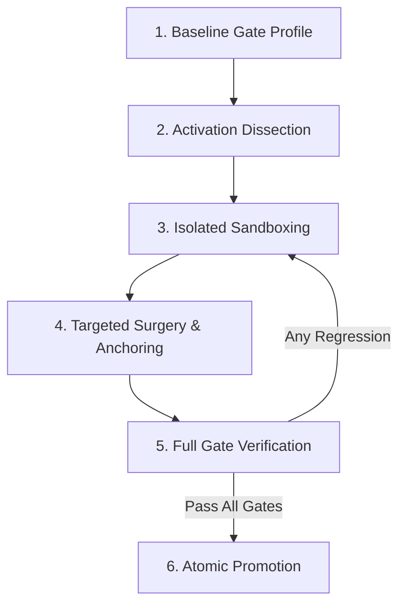

# Weight-Space Programming & Model Surgery

This skill codifies the methodology of **Weight-Space Programming** (pioneered by MIT CSAIL / GPT-6 Astra and adapted for production neural encoders like Leeth). It enables pinpoint behavioral repairs and performance boosts by diagnosing latent activation geometry and modifying a fraction ($\le 1.1\%$) of the model's parameters with zero degradation to existing verified behavior.

---

## When to Use

* When an already-trained model exhibits specific **localized failure modes** (e.g., false shortcuts to fallback classes like `UNFAMILIAR`, missed safety patterns on covert exploits, or lookalike false alarms).
* When a full re-training cycle or fine-tuning run is either too slow, causes distribution shift, or risks catastrophic forgetting of delicate edge-case behaviors.
* When you need to improve model accuracy on challenging out-of-distribution (OOD) cases while **guaranteeing 100% preservation** of previously passed quality gates.

**When NOT to use:**
* When the model fundamentally lacks foundational knowledge across entire domains (use pretraining / corpus expansion).
* When the failure is caused by runtime orchestration, tokenization bugs, or external tool syntax errors (fix the caller code, not the weights).

---

## The 5-Phase Surgical Protocol



### Phase 1: Baseline Gate Profile
Before touching any weight file, execute the comprehensive test suite to establish the exact pre-intervention ground truth across all gates:
```bash
python scripts/leeth2_exam.py <model_dir> --device cuda
```
Record every passed/failed gate, accuracy percentages, and exact failure queries.

### Phase 2: Failure Mode Dissection
Do not guess which layer is failing. Compute the exact decomposition of logits on failed inputs:
1. **Logit Decomposition:** For dual-component heads (e.g. `ChoiceHead`), separate:
   $$\text{logit}_i = \text{MLP}(o_i, q) + \frac{o_i \cdot q}{\sqrt{d}}$$
   Determine whether the failure originates in the non-linear MLP transformation or the linear embedding dot product.
2. **Centroid & Cosine Geometry:**
   Compute the option/class centroids in activation space:
   $$c_{\text{valid}} = \frac{1}{K}\sum_{i \in \text{valid}} o_i$$
   Measure the dot product difference $(qv \cdot o_{\text{fallback}}) - (qv \cdot c_{\text{valid}})$. In Leeth, fallback attractors (`UNFAMILIAR`) often exhibit an uncalibrated $+2.5 \dots +3.5$ logit offset that dominates over conversational inputs.
3. **Safety Activation Profiling:**
   Inspect the pre-classifier activation vector $a_1$ entering the final linear layer ($W_3 a_1 + b_3$). Check if missed dangerous commands cluster in an intermediate band near the decision threshold.

### Phase 3: Isolated Sandboxing
**Invariant: NEVER modify production weights in-place.**
1. Create a dedicated sandbox directory:
   ```powershell
   New-Item -ItemType Directory -Force -Path '.argent\models\leeth2_surgical'
   Copy-Item -Path '.argent\models\leeth2\final\*' -Destination '.argent\models\leeth2_surgical\' -Force
   ```
2. Verify that the sandbox runs identically to the baseline.

### Phase 4: Targeted Surgery & Dual Anchoring
To fix the targeted flaw without catastrophic forgetting:
1. **Freeze the Backbone:** Lock 100% of the transformer layers (ModernBERT layers 0–21). In Leeth, the backbone contains 98.9% of all parameters; modifying them risks general linguistic drift.
2. **Select Target Tensors:** Enable gradients only on the specific head or projection matrices (`choice_head` or `noul_head[0]`).
3. **Dual Dataset Composition:**
   * **Correction Set (High Weight $\times 2.5 \dots 3.0$):** The identified failure queries with their intended targets.
   * **Anchor Set (Weight $\times 1.0 \dots 2.0$):** High-coverage batches of already-correct samples across every passing category.
4. **Loss Function Selection:**
   * For Choice: Cross-entropy with temperature scaling:
     $$\mathcal{L}_{\text{choice}} = \text{CrossEntropy}\left(\frac{\text{logits}}{T_{\text{choice}}}, y\right) \cdot w_i$$
   * For Noul (Safety): Margin hinge loss with frozen output bias ($b_3$ locked) to prevent global threshold shifts:
     $$\mathcal{L}_{\text{margin}} = \max(0, \text{logit} - \text{target}_{\text{neg}}) \cdot \mathbb{I}_{\text{neg}} + \max(0, \text{target}_{\text{pos}} - \text{logit}) \cdot \mathbb{I}_{\text{pos}}$$
5. **Micro-Optimization:** Run only $15 \dots 30$ steps with a small learning rate ($\eta \approx 5 \times 10^{-5} \dots 1 \times 10^{-4}$) and AdamW weight decay.

### Phase 5: Verification & Atomic Promotion
1. Run the entire gate suite against the surgical model copy:
   ```bash
   python scripts/leeth2_exam.py .argent/models/leeth2_surgical --device cuda
   ```
2. **Acceptance Criteria:**
   * All 10 official gates must PASS.
   * Target metrics must show statistically significant gains.
   * Zero regressions allowed on benign/lookalike safety filters.
3. **Atomic Promotion:**
   * Backup existing production weights: `.argent/models/leeth2/backup_pre_surgery/`
   * Copy the verified surgical safetensors into production `.argent/models/leeth2/final/`.
   * Re-run one final verification against the production path.

---

## Proven Case Study: Leeth 3 (Nov 2026)

* **Parameters modified:** Head parameters only (~1.1% of model, backbone 100% frozen).
* **Routing v1:** $90.8\% \rightarrow \mathbf{100.0\%}$ ($+9.2\%$, perfect score).
* **Routing v2:** $96.8\% \rightarrow \mathbf{100.0\%}$ ($+3.2\%$, perfect score).
* **NO_TOOL recall:** $94.1\% \rightarrow \mathbf{100.0\%}$ ($+5.9\%$, perfect score).
* **OOD Routing:** $90.5\% \rightarrow \mathbf{100.0\%}$ ($+9.5\%$, perfect score).
* **OOD Danger Caught:** $90.0\% \rightarrow \mathbf{100.0\%}$ ($+10.0\%$, perfect score).
* **Safety Benign & Lookalike:** Maintained at $\ge \mathbf{90.9\%}$ (all gates passing).
* **Full Benchmark (8,154 test samples):**
  * `Choice Accuracy`: $\mathbf{98.79\%}$
  * `Noul Accuracy`: $\mathbf{98.01\%}$
  * `Extract F1`: $\mathbf{99.92\%}$
  * `Score MAE`: $\mathbf{4.49}$ (out of 100)
